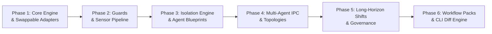
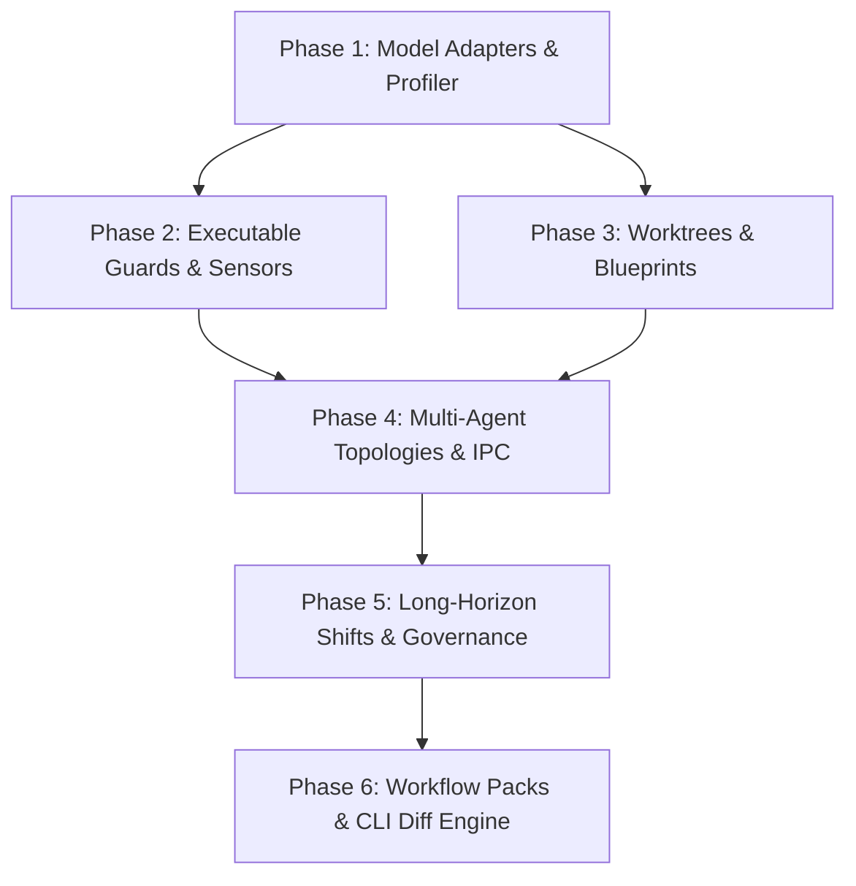

# Airframe Implementation Plan

> **Engineering Roadmap & Phased Execution Plan for the Airframe Agent Operating System**

---

## 1. Roadmap Overview & Milestones

The implementation of **Airframe** is divided into **6 sequential, milestone-driven phases**. Each phase builds on deterministic foundations before introducing higher-order autonomy:



| Phase | Milestone Name | Key Objective | Primary Deliverables |
| :---: | :--- | :--- | :--- |
| **1** | **Engine Foundation** | Swappable model adapters & prompt profiling | `pyproject.toml`, `ModelAdapter`, Gemini/Claude/OpenAI/Ollama adapters |
| **2** | **Guards & Sensors** | Deterministic boundary enforcement & self-repair | `ExecutableGuard` (Pydantic v2), Tier 1-3 Sensor pipeline |
| **3** | **Isolation & Blueprints** | Worktree isolation & dynamic agent manifests | `AgentBlueprint`, `WorktreeManager` (Git worktrees), Transcript partitioner |
| **4** | **Multi-Agent & IPC** | Supervisor/worker loops & reactive event bus | Async Mailbox, Supervisor, Evaluator-Optimizer loop, Cancellation cascades |
| **5** | **Long-Horizon & Governance**| Multi-shift durability & circuit breakers | State externalizer (`plan.md`, `task_queue.json`), Shift turnover, Stall detectors |
| **6** | **Workflows & CLI** | End-to-end developer experience & diff engine | `airframe` CLI, `workflows/` pack loader, Differential regression comparator |

---

## Current Implementation Verification Matrix

| Component / Requirement | Implemented Modules | Verification Tests | Notes |
| :--- | :--- | :--- | :--- |
| **Phase 1: Adapters & Prompt Profiler** (`FR-1`) | `src/airframe/adapters/` | `tests/unit/test_adapters.py` | Live vendor smoke suite opt-in via `AIRFRAME_LIVE_TESTS=1` in `tests/live/test_live_adapters.py` |
| **Phase 2: Guards, Sensors & Scoped Tools** (`FR-2`, `FR-3`, `FR-4`) | `src/airframe/guards/`, `src/airframe/sensors/`, `src/airframe/tools/` | `tests/unit/test_guards_and_sensors.py`, `tests/unit/test_tools.py` | `ruff`/`mypy` wrappers not bundled (use `ExitCodeSensor` or tools); Tier 2 uses `TokenOverlapSensor` Jaccard similarity |
| **Phase 3: Dual-Layer Isolation & Blueprints** (`FR-8`, `FR-9`) | `src/airframe/blueprints/`, `src/airframe/isolation/` | `tests/unit/test_blueprints.py`, `tests/unit/test_isolation.py`, `tests/integration/test_system_integration.py` | `workspace_mode="container"` is **Deferred (per [ADR 0001](docs/adr/0001-workflow-vs-container-isolation.md))** |
| **Phase 4: Multi-Agent IPC, Runtime & Tracing** (`FR-10`, `FR-12`, `FR-14`) | `src/airframe/ipc/`, `src/airframe/orchestration/`, `src/airframe/runner/`, `src/airframe/telemetry/tracer.py` | `tests/unit/test_orchestration.py`, `tests/unit/test_telemetry_tracer.py`, `tests/integration/test_runtime_runner.py` | `router` topology **Not Implemented**; W3C JSONL trace trees + optional OTel mirror |
| **Phase 5: State Persistence, Shifts & Governance** (`FR-11`, `FR-13`) | `src/airframe/state/disk.py`, `src/airframe/orchestration/shift.py`, `src/airframe/governance/circuit_breakers.py` | `tests/unit/test_long_horizon_and_governance.py`, `tests/integration/test_system_integration.py`, `tests/integration/test_runtime_runner.py` | Re-entrant `flock` + `.bak` recovery; shift git commit checkpoints wired in `WorkflowRunner` |
| **Phase 6: Workflow Packs & CLI Diff Engine** (`FR-5`, `FR-15`) | `src/airframe/workflows/loader.py`, `src/airframe/cli.py`, `src/airframe/telemetry/diff.py` | `tests/unit/test_cli.py`, `tests/unit/test_workflows_and_diff.py`, `tests/unit/test_weather_forecaster.py` | `airframe test`/`compare` enforce `expected` assertions & auto-discovered `sensors.py` |

---

## 2. Phase-by-Phase Execution Breakdown

### Phase 1: Engine Foundation & Swappable Adapters
**Goal:** Establish the project scaffolding and build a universal adapter layer that isolates model vendor differences.

* **Tasks:**
  1. **Scaffold Repository & Environment:**
     - Initialize `pyproject.toml` with `pydantic>=2.7`, `typer>=0.12`, `rich`, `httpx`, `pyyaml`, `jinja2`.
     - Configure development tooling: `ruff`, `mypy`, `pytest`, `pytest-asyncio`.
  2. **Abstract Base Adapter (`src/airframe/adapters/base.py`):**
     - Define `ModelAdapter(ABC)` with `invoke(prompt) -> str` and `invoke_contract(prompt, schema) -> T`.
     - Normalize token usage metadata (`input_tokens`, `output_tokens`, `latency_ms`).
  3. **Provider Implementations (`src/airframe/adapters/`):**
     - `openai_compatible.py`: Generic client for Ollama, vLLM, LM Studio, and OpenAI.
     - `gemini.py`: Google GenAI / Gemini API client with native system instruction support.
     - `anthropic.py`: Claude client with prompt caching and tool-use blocks.
  4. **Prompt Profiler (`src/airframe/adapters/profiler.py`):**
     - Jinja2 compiler mapping canonical task specifications to model-optimal formats (Claude XML tags vs. Gemini system blocks vs. OpenAI markdown).
* **Acceptance Criteria:**
  - Running `pytest tests/unit/test_adapters.py` validates that switching provider configurations returns identical normalized response types.

---

### Phase 2: Executable Guards & Multi-Tier Sensor Pipeline
**Goal:** Build the "Executable Guards Over Prose Rules" and "Guides Before, Sensors After" verification engine.

* **Tasks:**
  1. **Executable Guard (`src/airframe/guards/executable.py`):**
     - Pydantic v2 schema validator with automated feedback loop.
     - On validation error, construct a targeted repair prompt passing the exact `ValidationError` trace back to the model.
     - Enforce `max_retries` (default: 2) and payload byte/token caps.
  2. **Tier 1: Deterministic Sensors (`src/airframe/sensors/tier1_deterministic.py`):**
     - AST parsers, code linters (Ruff/Flake8), type checks (Mypy), regex patterns, and bash exit codes.
     - Zero-flake, zero-cost mandatory pass gate.
  3. **Tier 2: Semantic & Tool Sensors (`src/airframe/sensors/tier2_semantic.py`):**
     - Tool invocation accuracy check: verify tool name, argument types, and invocation sequences.
     - Fast cosine similarity against reference embeddings.
  4. **Tier 3: Calibrated Rubric Judge (`src/airframe/sensors/tier3_judge.py`):**
     - Structured evaluation rubric (accuracy, reasoning clarity, adherence).
     - Fixed seed, temperature=0 scoring with structured JSON reasoning extraction.
* **Acceptance Criteria:**
  - Schema violations trigger targeted auto-repair without manual intervention.
  - Tests verify that deterministic failures block Tier 3 judges from running (saving token costs).

---

### Phase 3: Dual-Layer Isolation & Dynamic Agent Blueprints
**Goal:** Ensure agents can be dynamically spawned with strict context and filesystem isolation.

* **Tasks:**
  1. **Agent Blueprint Schema (`src/airframe/blueprints/schema.py`):**
     - Pydantic schema for declarative agent manifests: `name`, `role`, `system_prompt`, `engine_binding`, `allowed_tools`, `workspace_mode`, `budget`.
  2. **Context Window Partitioner (`src/airframe/isolation/context.py`):**
     - Separate message history / transcript (`transcript.jsonl`) per agent instance.
     - Summary compressor: Extract finalized results and discard intermediate scratchpad tokens.
  3. **Git Worktree Manager (`src/airframe/isolation/worktree.py`):**
     - Automate `git worktree add .airframe/worktrees/<agent_id> -b agent/<agent_id>`.
     - Provide atomic execution directories for parallel workers.
     - Safe merge or prune on task completion/failure.
  4. **Ephemeral Sandbox (`src/airframe/isolation/sandbox.py`):**
     - Temporary directory creation for untrusted code execution with cleanup guarantees.
* **Acceptance Criteria:**
  - Parallel sub-agents running file-edit tasks execute in separate worktrees with zero git conflicts.
  - Parent agent context token count remains flat regardless of child agent exploration depth.

---

### Phase 4: Multi-Agent Orchestration & Asynchronous IPC
**Goal:** Implement supervisor/worker topologies, non-blocking messaging, and the independent evaluator loop.

* **Tasks:**
  1. **Typed Asynchronous Mailbox & Event Bus (`src/airframe/ipc/bus.py`):**
     - Inter-agent messaging: `send_message(recipient_id, payload)`.
     - Reactive wakeups: Parent yields execution and is woken up by the harness event loop when a child signals completion.
  2. **Supervisor Agent (`src/airframe/orchestration/supervisor.py`):**
     - Decomposes high-level instructions into atomic subtasks.
     - Delegates tasks to worker sub-agents; shielded from low-level tool noise.
  3. **Evaluator-Optimizer Loop (`src/airframe/orchestration/evaluator_optimizer.py`):**
     - Worker generates output $\rightarrow$ Independent Evaluator runs sensors $\rightarrow$ Returns structured critique $\rightarrow$ Worker optimizes until tests pass.
     - Completely eliminates self-evaluation bias.
  4. **Cancellation Cascades (`src/airframe/ipc/lifecycle.py`):**
     - Recursive termination: Killing a supervisor cleanly terminates all descendant agents, child processes, and temporary worktrees.
* **Acceptance Criteria:**
  - A mock coding task triggers worker $\rightarrow$ independent evaluator loop, successfully iterating until all tests pass.
  - Cancellation cleanly wipes child worktrees and aborts background tasks.

---

### Phase 5: Long-Horizon Durability & Governance
**Goal:** Enable multi-hour autonomous execution with disk-backed state and circuit breakers.

* **Tasks:**
  1. **State Externalizer (`src/airframe/state/disk.py`):**
     - Persist `plan.md` (milestone roadmap), `task_queue.json` (atomic task states), and `progress.log` (append-only history) to disk.
  2. **Shift Turnover Engine (`src/airframe/orchestration/shift.py`):**
     - Monitor context window consumption ($T_{\text{used}} / T_{\text{max}}$).
     - At $\ge 65\%$ context capacity, trigger automated handoff: summarize progress, commit git changes, wipe context, and spawn fresh shift.
  3. **Governance & Circuit Breakers (`src/airframe/governance/circuit_breakers.py`):**
     - Recursion depth limiter (max depth 2).
     - Spend and token ceilings ($USD cap).
     - Repetitive stall/loop detector (catches 3x identical tool failures).
     - Human-in-the-Loop (HITL) approval gate for sensitive operations.
* **Acceptance Criteria:**
  - Simulated long-running run successfully executes across 3 simulated "shifts" without context degradation.
  - Budget breach or infinite loop halts execution immediately.

---

### Phase 6: Workflow Packs, CLI & Differential Regression Engine
**Goal:** Deliver the final developer experience with self-contained workflow packs and the model comparison engine.

* **Tasks:**
  1. **Workflow Pack Loader (`src/airframe/workflows/loader.py`):**
     - Parse and validate `workflows/<use-case>/workflow.yaml` bundles.
  2. **CLI Engine (`src/airframe/cli.py`):**
     - `airframe run <workflow_path> [--input ...]`
     - `airframe test <workflow_path>`
     - `airframe compare <workflow_path> --baseline <modelA> --candidate <modelB>`
     - `airframe init workflow <name>`
  3. **Differential Regression Engine (`src/airframe/telemetry/diff.py`):**
     - Run candidate models against golden baseline datasets.
     - Generate terminal scorecards (Rich tables) and markdown diff reports comparing pass/fail deltas, token cost, and latency.
  4. **Reference Implementation (`workflows/pr-reviewer/`):**
     - Fully functioning PR code review workflow with custom contracts, deterministic linters, and golden test cases.
* **Acceptance Criteria:**
  - Running `airframe compare workflows/pr-reviewer --baseline model-a --candidate model-b` generates a scorecard highlighting pass/fail regressions.

---

## 3. Dependency Graph & Critical Path



---

## 4. Verification Status Summary

All Phases 1–6 and core runtime hardening compartments (`C1`–`C6`, see [`docs/specs/gap-remediation-spec.md`](docs/specs/gap-remediation-spec.md)) are implemented and verified offline via:

```bash
PYTHONPATH=src pytest tests/unit tests/integration -v
```

For real cloud/local endpoint smoke checks (`GeminiAdapter`, `AnthropicAdapter`, `OpenAICompatibleAdapter`):

```bash
AIRFRAME_LIVE_TESTS=1 PYTHONPATH=src pytest tests/live -v
```
