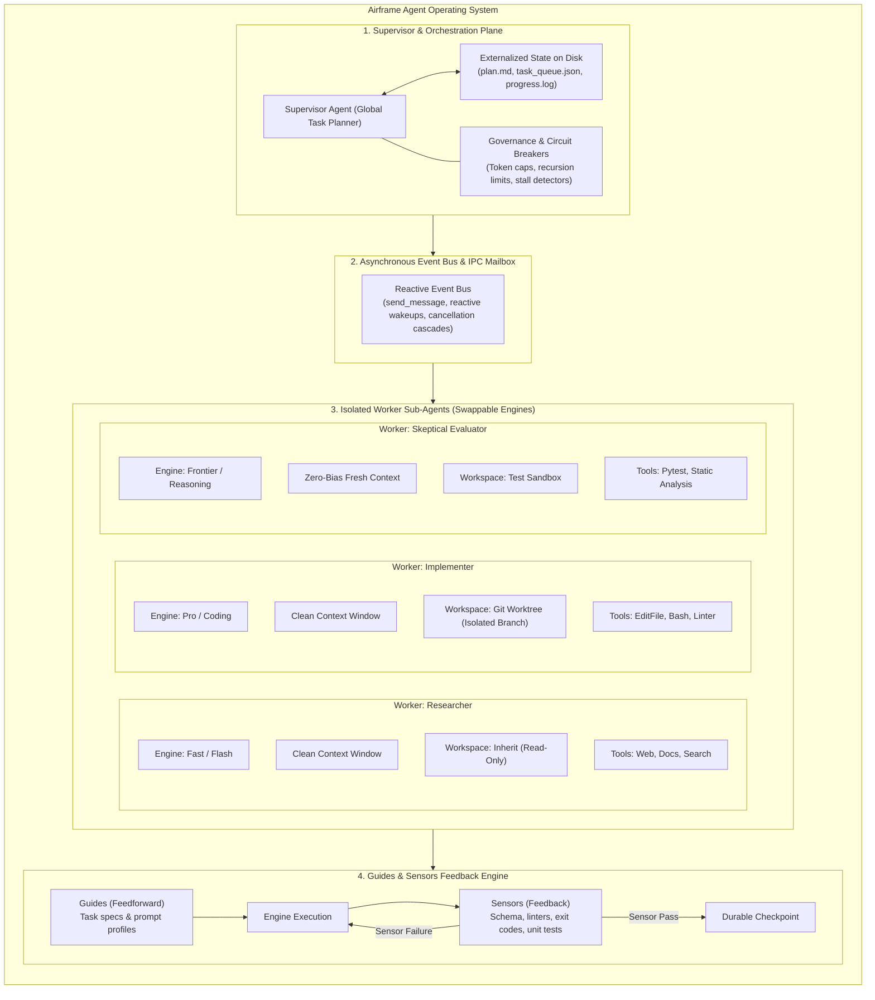

# Requirements Specification: Airframe (`airframe`)

> **The engineering chassis and operating system for reliable, long-horizon AI agents and swappable model engines.**

$$\text{Agent} = \text{Engine (Model)} + \text{Airframe (Harness)}$$

---

## 1. Executive Summary & Vision

**Airframe** (`airframe`) is a contract-first evaluation, execution, and multi-agent orchestration chassis. Just as an aerospace airframe can swap a Rolls-Royce engine for a Pratt & Whitney without altering flight controls, cockpit instruments, or safety margins, **Airframe** enables engineering teams to hot-swap AI model engines (Gemini, Claude, GPT, Ollama/local models) with zero downstream regression or turbulence.

Beyond single-turn model evaluation, Airframe serves as an **Agent Operating System** capable of supervising long-running workflows spanning hours or days, coordinating hierarchical supervisor/worker fleets, enforcing strict context and filesystem isolation, and maintaining deterministic safety guards.

---

## 2. Core Architectural Principles



### Principle 1: Guides Before, Sensors After
* **Guides (Feedforward):** Steer the agent *before* it takes action (lean prompt profiles, task specs, context diets).
* **Sensors (Feedback):** Detect failures *after* execution (AST linters, type checks, schema validation, exit codes, test suites).
* *Rule:* Never overload guides with rules that sensors should enforce. An agent without guides is aimless; an agent without sensors never learns when it failed.

### Principle 2: Executable Guards Over Prose Rules
* Prose rules (*"Please return strictly valid JSON"*, *"Never edit file X"*) are soft suggestions that fail probabilistically.
* Executable guards are deterministic programmatic boundaries (strict Pydantic v2 schemas, automated self-repair loops, token/byte ceilings, and OS-level file permissions).

### Principle 3: Dual-Layer Isolation (Anti-Pollution & Anti-Collision)
1. **Context Window Isolation:** Sub-agents execute inside private transcripts. Their noisy intermediate exploration tokens (e.g., 50k tokens of bash logs and file reads) are discarded from the supervisor's active context. Only compressed, structured summaries return.
2. **Filesystem Isolation (Git Worktrees):** Parallel workers execute in dedicated Git Worktrees (`git worktree add`). Workers cannot overwrite each other's files, stage conflicting commits, or corrupt the primary working tree.

### Principle 4: The Filesystem as Durable Memory (Long Horizons)
* Volatile LLM context memory degrades over time ("context rot" and "context anxiety").
* State is externalized to persistent disk files (`plan.md`, `task_queue.json`, `progress.log`).
* Long-running work is divided into **shifts**: when context usage crosses thresholds, the agent performs a clean handoff to disk, the context is wiped, and the next session boots cleanly.

### Principle 5: Decentralized Verification (Solving Self-Evaluation Bias)
* A model asked to evaluate its own output almost always rates itself favorably due to shared contextual bias.
* Verification must be performed by independent **Evaluator Sub-Agents** running isolated sensor suites on fresh context.

---

## 3. Functional Requirements (FR)

### Phase 1: Core Engine, Contracts & Evaluation

#### FR-1: Unified Model Adapter Gateway (Swappable Engines)
- [ ] Abstract base class (`ModelAdapter`) defining a uniform interface:
  ```python
  def invoke(self, prompt: str, **kwargs) -> str: ...
  def invoke_contract(self, prompt: str, schema: type[T], **kwargs) -> T: ...
  ```
- [ ] Initial provider implementations:
  - **Local/OSS Models:** OpenAI-compatible endpoint (Ollama, vLLM, LM Studio).
  - **Cloud Providers:** Google Gemini, Anthropic Claude, OpenAI.
- [ ] **Prompt Profiling:** Compile canonical task intent into provider-specific formats (e.g., XML tags for Claude, system instruction blocks for Gemini, Markdown sections for GPT).

#### FR-2: Executable Guards & Schema Self-Repair
- [ ] Enforce output schemas via Pydantic v2 / JSON Schema.
- [ ] Automated validation & repair loop:
  - Parse raw model output against target schema.
  - On failure, catch `ValidationError` and formulate a focused feedback prompt showing the exact violation.
  - Retry up to `max_retries` (default: 2) before raising a hard failure.
- [ ] Payload bounds: Programmatically reject or truncate responses that breach size/token ceilings.

#### FR-3: The Sensor Pipeline (Multi-Tier Evaluation)
- [ ] **Tier 1 (Deterministic Sensors - Mandatory Gate):**
  - Schema validity and field type checking.
  - Regex pattern matching and exact keyword assertions.
  - Code linting (Ruff/Flake8), type checks (Mypy), and execution exit codes.
  - Zero false-positive / zero-flake baseline.
- [ ] **Tier 2 (Semantic & Tool Sensors):**
  - Tool invocation validation: correct function name, valid parameter values, and valid invocation order.
  - Semantic distance: cosine similarity against golden outputs using fast embeddings.
- [ ] **Tier 3 (Model-as-a-Judge / Rubric Gate):**
  - Structured evaluation rubrics (factual accuracy, reasoning clarity, adherence).
  - Reference-free and reference-based judging with calibrated temperature=0 scoring.

#### FR-4: Dynamic Tool Scoping & Context Diet
- [ ] Tool registry supporting tool grouping by task phase (e.g., `Discovery`, `Execution`, `Verification`).
- [ ] Dynamic injector: Provide the model only with tools mapped to the active phase (max 3–5 tools at once).
- [ ] Context budgeter: Measure prompt token footprint and warn when guide files exceed recommended token ceilings.

#### FR-5: Differential Regression & Baseline Diffing
- [ ] CLI scorecard generator: Terminal table displaying Pass/Fail rate, latency (p50, p95), and token counts.
- [ ] Exportable artifacts: Markdown summary and machine-readable JSON reports.
- [ ] **Differential Comparator (`airframe compare`)**:
  - Compare Run A (Baseline Model) vs Run B (Candidate Model).
  - Detect regressions (cases passed by A but broken by B).
  - Highlight improvements, cost delta, and latency trade-offs.

---

### Phase 2: Multi-Agent Systems, Long Horizons & Isolation

#### FR-8: Dynamic Agent Registry & Blueprint Engine
- [ ] Declarative Agent Blueprint schema (YAML / Pydantic):
  ```yaml
  name: "code-implementer"
  role: "Senior Backend Developer"
  system_prompt: "prompts/implementer.jinja2"
  model_binding: "gemini-2.0-flash"
  allowed_tools: ["read_file", "edit_file", "run_command"]
  workspace_mode: "branch"
  budget:
    max_tokens: 150000
    timeout_seconds: 600
  ```
- [ ] Runtime dynamic registration: `airframe.define_agent(blueprint)`.
- [ ] Dynamic spawning: `airframe.spawn_agent(name_or_blueprint, task_prompt, parent_id)`.
- [ ] Agent Lifecycle State Machine:
  - States: `PENDING` $\rightarrow$ `RUNNING` $\rightarrow$ `WAITING_INPUT` $\rightarrow$ `COMPLETED` / `FAILED` / `KILLED`.
  - Hierarchical tracking: Parent-child relationship tracking in an execution DAG.

#### FR-9: Dual-Layer Isolation Engine
- [ ] **Context Window Isolation:**
  - Every spawned sub-agent maintains its own isolated message history/transcript file (`transcript.jsonl`).
  - Child agents communicate with parents strictly via structured completion contracts or compressed summaries.
  - Intermediate scratch tokens are archived to disk but never injected into parent context.
- [ ] **Workspace / Filesystem Isolation:**
  - **`inherit` Mode:** Sub-agent executes in the parent's directory (read-only research or non-modifying analysis).
  - **`branch` Mode (Git Worktrees):** Automatically spin up an isolated Git Worktree:
    ```bash
    git worktree add .airframe/worktrees/<agent_id> -b agent/<agent_id>
    ```
    All file reads/writes/commands are isolated to this directory.
    On successful verification, the supervisor merges or creates a clean pull request; on failure, the worktree is deleted without dirtying the working directory.
  - **`ephemeral_sandbox` Mode:** Isolated disposable temporary directory for untrusted code execution.

#### FR-10: Supervisor-Worker Orchestration Topologies
- [ ] **Topology 1: Hierarchical (Supervisor / Worker Fleet):**
  - Supervisor manages the master roadmap (`plan.md`) and delegates atomic subtasks to workers.
  - Supervisor is shielded from low-level tool logs, only receiving structured status signals.
- [ ] **Topology 2: Evaluator-Optimizer (Generator / Critic):**
  - Worker writes code/output $\rightarrow$ Independent Evaluator runs sensors $\rightarrow$ Returns structured critique $\rightarrow$ Worker optimizes until tests pass.
- [ ] **Topology 3: Router / Dispatcher:**
  - Classifies user request and routes directly to the optimal specialized worker.

#### FR-11: Long-Horizon Persistence & Multi-Shift Durability
- [ ] **Externalized State Management:**
  - Automated persistence of:
    - `plan.md`: Human and agent-readable high-level milestone progress.
    - `task_queue.json`: Structured backlog of tasks (`pending`, `in_progress`, `done`).
    - `progress.log`: Append-only handoff notes.
- [ ] **Shift Turnover Engine (Context Compaction):**
  - Monitor context window consumption ($T_{\text{used}} / T_{\text{max}}$).
  - When consumption exceeds threshold (e.g., 65%), trigger automated shift turnover:
    1. Active agent summarizes delta accomplishments into `progress.log`.
    2. Commit active state to git worktree.
    3. Terminate current session.
    4. Spawn a fresh session with clean context, bootloaded strictly from disk state files.

#### FR-12: Reactive IPC, Event Bus & Cancellation Cascades
- [ ] **Typed Asynchronous Mailbox:**
  - Inter-agent communication via typed messages: `send_message(recipient_id, message_payload)`.
- [ ] **Reactive Wakeup (Zero Polling):**
  - Parent agents enter a non-blocking waiting state while workers run in background.
  - When a worker finishes or raises a blocker, the harness event loop automatically resumes the parent.
- [ ] **Recursive Cancellation Cascades:**
  - Terminating or timing out a parent agent recursively terminates all descendant sub-agents, halts running child processes, and cleans up temporary worktrees.

#### FR-13: Resource Governance, Circuit Breakers & Budget Caps
- [ ] **Recursion Depth Ceiling:** Hard limit on sub-agent nesting (default: max depth 2: Supervisor $\rightarrow$ Worker $\rightarrow$ Sub-worker).
- [ ] **Spend & Token Ceilings:**
  - Hard spend limits ($USD) and token counts per sub-agent and per global run.
  - Immediate execution halt when budget thresholds are breached.
- [ ] **Stall & Loop Detectors:**
  - Detect repetitive identical tool calls with recurring errors (default: threshold 3).
  - Automatically interrupt loop and escalate to supervisor or human.
- [ ] **Human-in-the-Loop (HITL) Approval Gates:**
  - Configurable policy engine flagging destructive actions (e.g., dropping databases, force pushes, external mutations) for interactive human confirmation.

#### FR-14: Hierarchical Observability & Distributed Tracing
- [ ] Unified OpenTelemetry-compatible trace trees linking Root Task $\rightarrow$ Supervisor $\rightarrow$ Child Agents $\rightarrow$ Tool Invocations $\rightarrow$ Sensor Results.
- [ ] Per-agent session replay: Record complete step trajectories into `transcript.jsonl` for offline debugging, regression testing, and post-mortem analysis.

---

## 4. Non-Functional Requirements (NFR)

* **NFR-1 (Determinism & Zero Flakes):** Sensor checks must be 100% deterministic. LLM-based evaluators must enforce fixed seeds and zero temperature.
* **NFR-2 (Strict Isolation):** Airframe must never expose model-specific quirks, headers, or raw SDK errors to downstream business logic.
* **NFR-3 (Extensibility):** Adding a new provider adapter, custom evaluator, or tool must be a standalone class addition without modifying runner core code.
* **NFR-4 (Security & Safe Execution):** Tool executions and code runners must operate within configured permission boundaries; API keys are sourced strictly from environment variables.
* **NFR-5 (Resource Cleanup):** Worktrees, temporary sandboxes, and child processes must be guaranteed to clean up on both normal completion and SIGINT/SIGTERM crashes.

---

## 5. Directory Structure & Layout

```
airframe/
├── README.md
├── REQUIREMENTS.md
├── pyproject.toml
├── src/
│   └── airframe/
│       ├── adapters/         # Swappable model engines (Gemini, Claude, OpenAI, Ollama)
│       ├── blueprints/       # Agent manifests, schemas, and dynamic definitions
│       ├── orchestration/    # Supervisor, worker pool, topologies, and shift turnover
│       ├── isolation/        # Git worktree managers, context partitioners, sandboxes
│       ├── ipc/              # Asynchronous event bus, mailbox, reactive wakeups
│       ├── guards/           # Executable guards, Pydantic schemas, repair loops
│       ├── sensors/          # Tier 1 deterministic, Tier 2 semantic, Tier 3 judges
│       ├── tools/            # Scoped tool registries and dynamic injectors
│       ├── governance/       # Budget trackers, loop detectors, HITL approval gates
│       ├── state/            # Checkpoints, disk state (plan.md, task_queue.json)
│       ├── telemetry/        # Distributed tracing, transcript loggers, replay
│       ├── runner/           # Async execution engine, concurrency
│       └── cli.py            # Command-line interface (`airframe run`, `airframe compare`)
├── tests/
│   ├── unit/                 # Unit tests for airframe modules
│   └── integration/          # Multi-agent isolation & worktree tests
└── datasets/
    ├── smoke.yaml            # Sanity check suite
    └── benchmark_core.yaml   # Comprehensive evaluation benchmark
```
