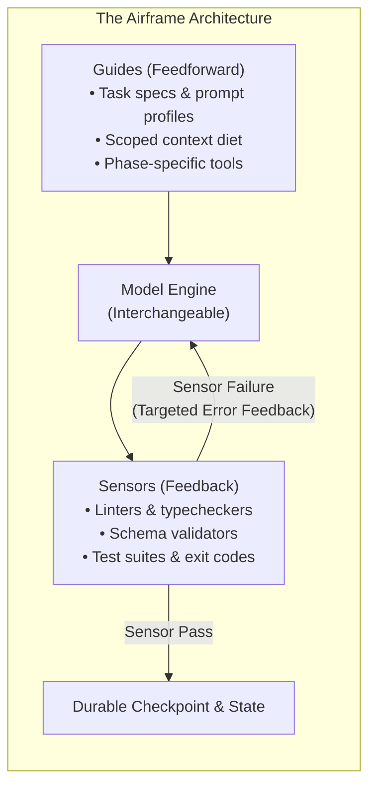

# Requirements Specification: Airframe (`airframe`)

## 1. Executive Summary & Core Formula

**Airframe** (`airframe`) is an evaluation, execution, and verification chassis designed to decouple large language models (LLMs) and agentic workflows from application logic. It allows engineering teams to benchmark, validate, and hot-swap underlying models (e.g., Gemini, Claude, GPT, Ollama/local models) with zero downstream regressions.

### The Foundational Law
$$\text{Agent} = \text{Engine (Model)} + \text{Airframe (Harness)}$$

* **The Engine (Model):** Provides raw token generation, semantic reasoning, and probabilistic predictions.
* **The Airframe (Harness):** Provides flight controls (guides), avionics and sensors (feedback), structural firewalls (executable guards), and telemetry.
* **The Core Premise:** Most agent failures (infinite loops, parameter hallucinations, rule amnesia) are **structural airframe failures**, not model intelligence deficits. Tweaking prompts or waiting for next-gen models cannot fix a compromised chassis.

---

## 2. Core Architectural Principles



### Principle 1: Guides Before, Sensors After
* **Guides (Feedforward):** Steer the model *before* it takes an action (concise task specifications, canonical prompt profiles, context pruning).
* **Sensors (Feedback):** Detect failures *after* execution (schema validators, AST linters, unit tests, exit codes).
* *Rule:* Never overload guides with rules that sensors should enforce. An agent without guides is aimless; an agent without sensors never learns when it failed.

### Principle 2: Executable Guards Over Prose Rules
* Prose rules (*"Please always return valid JSON"*, *"Do not exceed 30 lines"*) are soft suggestions that fail probabilistically.
* Executable guards are deterministic programmatic boundaries (strict Pydantic schemas, file-write byte limits, sandbox permission gates, and automated self-repair loops).

### Principle 3: Context Diet & Dynamic Tool Scoping
* Monolithic prompt bloat causes "rule fatigue" and attention degradation.
* Exposing 30+ tools causes parameter hallucinations and selection paralysis. The airframe dynamically filters and exposes only the 3–5 tools relevant to the active task phase.

### Principle 4: Durable State & Reversible Checkpointing
* Models are strictly stateless; the airframe is stateful.
* Every meaningful action is checkpointed with rollback capability. If a step fails sensors or times out, the airframe recovers without amnesia or rerunning previous successful steps.

---

## 3. Functional Requirements (FR)

### FR-1: Unified Model Adapter Gateway (Swappable Engines)
- [ ] Implement an abstract base class (`ModelAdapter`) defining a uniform interface:
  ```python
  def invoke(self, prompt: str, **kwargs) -> str: ...
  def invoke_contract(self, prompt: str, schema: type[T], **kwargs) -> T: ...
  ```
- [ ] Initial provider implementations:
  - **Local/OSS Models:** OpenAI-compatible endpoint (Ollama, vLLM, LM Studio).
  - **Cloud Providers:** Google Gemini, Anthropic Claude, OpenAI.
- [ ] **Prompt Profiling:** Compile canonical task intent into provider-specific formats (e.g., XML tags for Claude, system instruction blocks for Gemini, Markdown sections for GPT).

### FR-2: Executable Guards & Schema Self-Repair
- [ ] Enforce output schemas via Pydantic v2 / JSON Schema.
- [ ] Automated validation & repair loop:
  - Parse raw model output against target schema.
  - On failure, catch `ValidationError` and formulate a focused feedback prompt showing the exact violation.
  - Retry up to `max_retries` (default: 2) before raising a hard failure.
- [ ] Payload bounds: Programmatically reject or truncate responses that breach size/token ceilings.

### FR-3: The Sensor Pipeline (Multi-Tier Evaluation)
- [ ] **Tier 1 (Deterministic Sensors - Mandatory Gate):**
  - Schema validity and field type checking.
  - Regex pattern matching and exact keyword assertions.
  - Code linting (Ruff/Flake8), type checks (Mypy), and execution exit codes.
  - Zero false-positive / zero-flake baseline.
- [ ] **Tier 2 (Semantic & Tool Sensors):**
  - Tool invocation validation: correct function name, valid parameter values, and valid invocation order.
  - Semantic distance: cosine similarity against golden outputs using fast embeddings.
- [ ] **Tier 3 (Model-as-a-Judge / Rubric Gate):**
  - Structured evaluation rubrics (factual accuracy, reasoning clarity, adherence).
  - Reference-free and reference-based judging with calibrated temperature=0 scoring.

### FR-4: Dynamic Tool Scoping & Context Diet
- [ ] Tool registry that supports grouping tools by task phases (e.g., `Discovery`, `Execution`, `Verification`).
- [ ] Dynamic injector: Provide the model only with tools mapped to the active phase.
- [ ] Context budgeter: Measure prompt token footprint and warn when guide files exceed recommended token ceilings (avoiding prompt bloat).

### FR-5: State Durability & Step Checkpointing
- [ ] Persist execution state, intermediate tool responses, and sensor outcomes to a structured session log (`jsonl` / SQLite).
- [ ] Safe rollback: Revert state if a tool call leaves the environment in an invalid state.
- [ ] Resume capability: Pick up interrupted runs without re-executing completed deterministic steps.

### FR-6: Test Bed & Golden Dataset Management
- [ ] Load test cases from declarative YAML/JSON files.
- [ ] Test case schema:
  - `id`: Unique identifier (e.g., `extract-001`).
  - `category`: Category (`smoke`, `edge_case`, `tool_use`, `adversarial`).
  - `input`: Input prompt payload and parameters.
  - `guides`: Optional specific task guidelines injected.
  - `expected`: Golden references, expected schema, or deterministic assertions.
  - `tolerance`: Permissible semantic variance band.

### FR-7: Scorecard & Differential Regression Engine
- [ ] CLI scorecard generator: Terminal table displaying Pass/Fail rate, latency (p50, p95), and token counts.
- [ ] Exportable artifacts: Markdown summary and machine-readable JSON reports.
- [ ] **Differential Comparator (`airframe compare`)**:
  - Compare Run A (Baseline Model) vs Run B (Candidate Model).
  - Detect regressions (cases passed by A but broken by B).
  - Highlight improvements, cost delta, and latency trade-offs.

---

## 4. Non-Functional Requirements (NFR)

* **NFR-1 (Determinism & Zero Flakes):** Sensor checks must be 100% deterministic. LLM-based evaluators must enforce fixed seeds and zero temperature.
* **NFR-2 (Strict Isolation):** Airframe must never expose model-specific quirks, headers, or raw SDK errors to downstream business logic.
* **NFR-3 (Extensibility):** Adding a new provider adapter or custom evaluator must be a standalone class addition without modifying runner core code.
* **NFR-4 (Security & Safe Execution):** Tool executions and code runners must operate within configured permission boundaries; API keys are sourced strictly from environment variables.

---

## 5. Directory Structure & Layout

```
airframe/
├── README.md
├── REQUIREMENTS.md
├── pyproject.toml
├── src/
│   └── airframe/
│       ├── adapters/         # Swappable model engines (Gemini, Claude, OpenAI, Ollama)
│       ├── guards/           # Executable guards, Pydantic schemas, repair loops
│       ├── sensors/          # Tier 1 deterministic, Tier 2 semantic, Tier 3 judges
│       ├── tools/            # Scoped tool registries and dynamic injectors
│       ├── state/            # Checkpoints, session logs, rollback handlers
│       ├── runner/           # Async execution engine, concurrency, telemetry
│       ├── storage/          # Baselines, caches, and report generators
│       └── cli.py            # Command-line interface (`airframe run`, `airframe compare`)
├── tests/
│   ├── unit/                 # Unit tests for the airframe infrastructure
│   └── fixtures/             # Mock responses and fixtures
└── datasets/
    ├── smoke.yaml            # Sanity check suite
    └── benchmark_core.yaml   # Comprehensive evaluation benchmark
```
