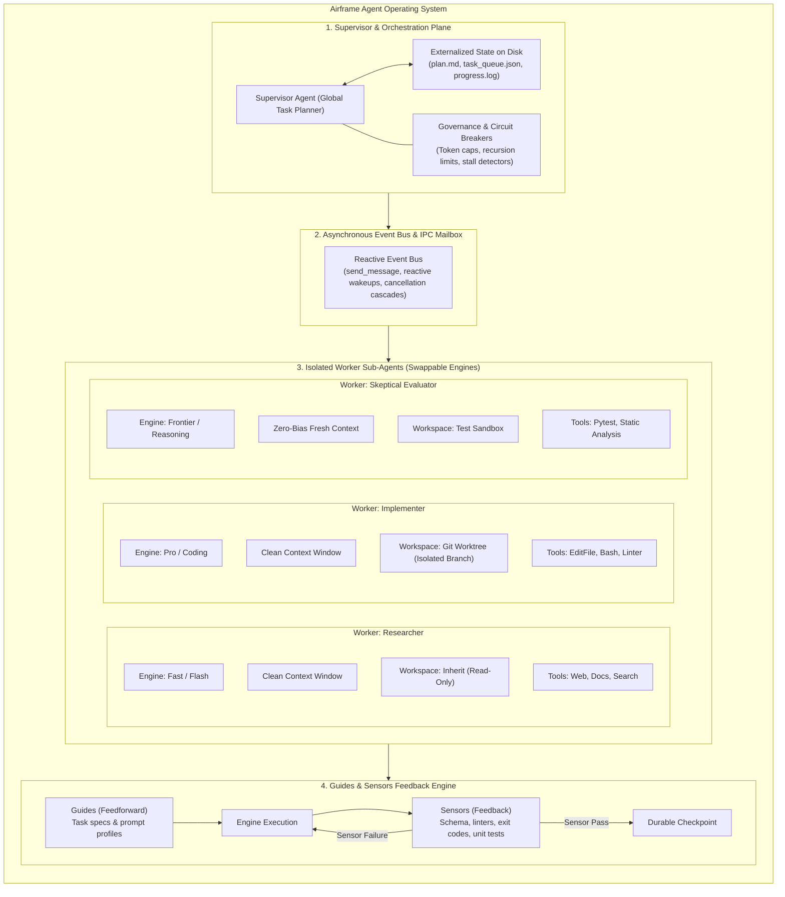

# Requirements Specification: Airframe (`airframe`)

> **The engineering chassis and operating system for reliable, long-horizon AI agents and swappable model engines.**

$$\text{Agent} = \text{Engine (Model)} + \text{Airframe (Harness)}$$

---

## 1. Executive Summary & Vision

**Airframe** (`airframe`) is a contract-first evaluation, execution, and multi-agent orchestration chassis. Just as an aerospace airframe can swap a Rolls-Royce engine for a Pratt & Whitney without altering flight controls, cockpit instruments, or safety margins, **Airframe** enables engineering teams to hot-swap AI model engines (Gemini, Claude, GPT, Ollama/local models) with zero downstream regression or turbulence.

Beyond single-turn model evaluation, Airframe serves as an **Agent Operating System** capable of supervising long-running workflows spanning hours or days, coordinating hierarchical supervisor/worker fleets, enforcing strict context and filesystem isolation, and maintaining deterministic safety guards.

---

## 2. Core Architectural Principles



### Principle 1: Guides Before, Sensors After
* **Guides (Feedforward):** Steer the agent *before* it takes action (lean prompt profiles, task specs, context diets).
* **Sensors (Feedback):** Detect failures *after* execution (AST linters, type checks, schema validation, exit codes, test suites).
* *Rule:* Never overload guides with rules that sensors should enforce. An agent without guides is aimless; an agent without sensors never learns when it failed.

### Principle 2: Executable Guards Over Prose Rules
* Prose rules (*"Please return strictly valid JSON"*, *"Never edit file X"*) are soft suggestions that fail probabilistically.
* Executable guards are deterministic programmatic boundaries (strict Pydantic v2 schemas, automated self-repair loops, token/byte ceilings, and OS-level file permissions).

### Principle 3: Dual-Layer Isolation (Anti-Pollution & Anti-Collision)
1. **Context Window Isolation:** Sub-agents execute inside private transcripts. Their noisy intermediate exploration tokens (e.g., 50k tokens of bash logs and file reads) are discarded from the supervisor's active context. Only compressed, structured summaries return.
2. **Filesystem Isolation (Git Worktrees):** Parallel workers execute in dedicated Git Worktrees (`git worktree add`). Workers cannot overwrite each other's files, stage conflicting commits, or corrupt the primary working tree.

### Principle 4: The Filesystem as Durable Memory (Long Horizons)
* Volatile LLM context memory degrades over time ("context rot" and "context anxiety").
* State is externalized to persistent disk files (`plan.md`, `task_queue.json`, `progress.log`).
* Long-running work is divided into **shifts**: when context usage crosses thresholds, the agent performs a clean handoff to disk, the context is wiped, and the next session boots cleanly.

### Principle 5: Decentralized Verification (Solving Self-Evaluation Bias)
* A model asked to evaluate its own output almost always rates itself favorably due to shared contextual bias.
* Verification must be performed by independent **Evaluator Sub-Agents** running isolated sensor suites on fresh context.

### Principle 6: Self-Contained "Workflow Packs" (Domain Isolation)
* Adding new use cases must never pollute core engine code.
* Every use case is packaged into an isolated, self-contained **Workflow Pack** under `workflows/<use-case>/` containing its own manifests, blueprints, guides, contracts, sensors, and regression testbeds.

---

## 3. Functional Requirements (FR)

### Phase 1: Core Engine, Contracts & Evaluation

#### FR-1: Unified Model Adapter Gateway (Swappable Engines)
- [x] Abstract base class (`ModelAdapter`) defining a uniform async interface (`src/airframe/adapters/base.py`, verified in `tests/unit/test_adapters.py`):
  ```python
  async def invoke(self, prompt: str, **kwargs) -> ModelResponse: ...
  async def invoke_contract(self, prompt: str, schema: type[T], **kwargs) -> tuple[T, ModelResponse]: ...
  ```
- [x] Initial provider implementations (verified offline in `tests/unit/test_adapters.py`; opt-in live HTTP checks in `tests/live/test_live_adapters.py`):
  - **Local/OSS Models:** OpenAI-compatible endpoint (`OpenAICompatibleAdapter` for Ollama, vLLM, LM Studio, OpenAI).
  - **Cloud Providers:** Google Gemini (`GeminiAdapter`), Anthropic Claude (`AnthropicAdapter`), OpenAI (`OpenAICompatibleAdapter`).
- [x] **Prompt Profiling:** Compile canonical task intent into provider-specific formats via Jinja2 (`PromptProfiler` in `src/airframe/adapters/profiler.py`, verified in `tests/unit/test_adapters.py`).

#### FR-2: Executable Guards & Schema Self-Repair
- [x] Enforce output schemas via Pydantic v2 / JSON Schema (`ExecutableGuard`, `SchemaSensor` in `src/airframe/guards/executable.py` and `src/airframe/sensors/schema.py`, verified in `tests/unit/test_guards_and_sensors.py`).
- [x] Automated validation & repair loop (`ModelAdapter.invoke_contract` + `run_with_retry`, verified in `tests/unit/test_adapters.py`).
- [x] Payload bounds: Programmatically reject payloads breaching byte ceilings or forbidden substrings (`PayloadBounds`, verified in `tests/unit/test_guards_and_sensors.py`).

#### FR-3: The Sensor Pipeline (Multi-Tier Evaluation)
- [x] **Tier 1 (Deterministic Sensors - Mandatory Gate):** `SchemaSensor`, `PythonASTSensor`, `RegexSensor`, `KeywordSensor`, `ExitCodeSensor` (`src/airframe/sensors/`, verified in `tests/unit/test_guards_and_sensors.py`), plus workflow sensor discovery (`WorkflowPack.load_sensors`, verified in `tests/unit/test_workflows_and_diff.py` & `tests/unit/test_cli.py`). *Note: external subprocess `ruff`/`mypy` wrappers are not bundled directly; arbitrary linters can be invoked via tools + `ExitCodeSensor`.*
- [x] **Tier 2 (Semantic & Tool Sensors):** `ToolCallValidatorSensor` and `TokenOverlapSensor` (token Jaccard similarity, `src/airframe/sensors/tier2_semantic.py`, verified in `tests/unit/test_guards_and_sensors.py` & `tests/unit/test_tools.py`). *Note: uses deterministic Jaccard token overlap rather than dense vector embeddings.*
- [x] **Tier 3 (Model-as-a-Judge / Rubric Gate):** `ModelJudgeSensor` with `JudgeRubric` and Tier 1 fast-fail short-circuiting (`src/airframe/sensors/tier3_judge.py`, verified in `tests/unit/test_guards_and_sensors.py`).

#### FR-4: Dynamic Tool Scoping & Context Diet
- [x] Zero-decorator tool registry supporting phase grouping (`ToolRegistry` in `src/airframe/tools/registry.py`, verified in `tests/unit/test_tools.py`).
- [x] Dynamic phase-scoped injector enforcing max 3–5 tools per phase (`ScopedToolInjector(max_tools_per_phase=5)` in `src/airframe/tools/scoper.py` + governed `ToolRunner` in `src/airframe/tools/runner.py`, verified in `tests/unit/test_tools.py` & `tests/integration/test_runtime_runner.py`).
- [x] Context budgeter measuring guide token footprints and warning / erroring when exceeding limits (`ContextBudgeter` in `src/airframe/tools/scoper.py`, wired into `WorkflowRunner`, verified in `tests/unit/test_tools.py`).

#### FR-5: Differential Regression & Baseline Diffing
- [x] CLI scorecard generator displaying Pass/Fail rate, latency (`p50`, `p95`), and token counts (`RunScorecard` in `src/airframe/telemetry/diff.py`, verified in `tests/unit/test_workflows_and_diff.py`).
- [x] Exportable artifacts: Markdown (`render_markdown()`) and machine-readable JSON (`model_dump_json()`, verified in `tests/unit/test_workflows_and_diff.py`).
- [x] **Differential Comparator (`airframe compare`)**: Compares Baseline vs Candidate via `WorkflowRunner` + real semantic assertions + `compare_scorecards`, flagging `DRY-RUN MOCK MODE` clearly when run offline (`src/airframe/cli.py`, verified in `tests/unit/test_workflows_and_diff.py`).

---

### Phase 2: Multi-Agent Systems, Long Horizons & Isolation

#### FR-8: Dynamic Agent Registry & Blueprint Engine
- [x] Declarative Agent Blueprint schema (YAML / Pydantic `AgentBlueprint` in `src/airframe/blueprints/schema.py`, verified in `tests/unit/test_blueprints.py`).
- [x] Agent Registry (`AgentRegistry` in `src/airframe/blueprints/registry.py`, verified in `tests/unit/test_blueprints.py`) and strict `entrypoint_agent` resolution in `WorkflowRunner` (verified in `tests/integration/test_runtime_runner.py` & `tests/unit/test_cli.py`).
- [x] Agent Lifecycle State Machine (`PENDING`, `RUNNING`, `WAITING_INPUT`, `COMPLETED`, `FAILED`, `CANCELLED` + parent-child DAG in `src/airframe/ipc/lifecycle.py`, verified in `tests/unit/test_orchestration.py`).

#### FR-9: Dual-Layer Isolation Engine
- [x] **Context Window Isolation:** `ContextPartitioner` writes crash-safe `fsync` JSONL transcripts (`transcript.jsonl`), recovers from truncated tails via `.corrupt_tail` quarantine (`read_transcript`), and emits `CompressedHandoff` summaries (`src/airframe/isolation/context.py`, verified in `tests/unit/test_isolation.py`).
- [x] **Workspace / Filesystem Isolation:** `get_workspace(mode=...)` (`src/airframe/isolation/workspace.py`) supporting:
  - `inherit` (`SharedWorkspace`)
  - `branch` (`WorktreeManager` with locked `.registry.lock`, `WorktreeConflictError` live-sibling protection, deterministic `base_commit` `get_diff()`, `SIGKILL` stale orphan reaper, and `SIGINT`/`SIGTERM`/`atexit` cleanup, verified in `tests/unit/test_isolation.py` & `tests/integration/test_system_integration.py`)
  - `sandbox` (`EphemeralSandbox` tempdir cleanup, verified in `tests/unit/test_isolation.py`)
- [ ] **Container Isolation (`workspace_mode="container"`):** **Deferred (per [ADR 0001](docs/adr/0001-workflow-vs-container-isolation.md))**.

#### FR-10: Supervisor-Worker Orchestration Topologies
- [x] **Topology 1: Hierarchical (`orchestrator-workers`):** `SupervisorAgent` + `WorkflowRunner._run_orchestrator_workers()` (`src/airframe/orchestration/supervisor.py`, `src/airframe/runner/engine.py`, verified in `tests/unit/test_orchestration.py`, `tests/integration/test_system_integration.py`, & `tests/integration/test_runtime_runner.py`).
- [x] **Topology 2: Evaluator-Optimizer (`evaluator-optimizer`):** `EvaluatorOptimizerLoop` + `WorkflowRunner._run_evaluator_optimizer()` (`src/airframe/orchestration/evaluator_optimizer.py`, `src/airframe/runner/engine.py`, verified in `tests/unit/test_orchestration.py` & `tests/integration/test_runtime_runner.py`).
- [ ] **Topology 3: Router / Dispatcher (`router`):** **Not Implemented** (`WorkflowManifest.topology` supports `"single-agent"`, `"orchestrator-workers"`, `"evaluator-optimizer"`).

#### FR-11: Long-Horizon Persistence & Multi-Shift Durability
- [x] **Externalized State Management:** `DiskStateManager` (`atomic_write_text`, re-entrant `fcntl.flock`, `.bak` self-healing recovery) managing `plan.md`, `task_queue.json`, and `progress.log` (`src/airframe/state/disk.py`, verified in `tests/unit/test_long_horizon_and_governance.py` & `tests/integration/test_system_integration.py`).
- [x] **Shift Turnover Engine:** `ShiftTurnoverEngine` (`should_turnover`, `execute_turnover(..., worktree_dir=...)` with real git checkpoint commits, in-memory history wipe, and `bootload_shift_prompt()` wired inside `WorkflowRunner`, verified in `tests/unit/test_long_horizon_and_governance.py` & `tests/integration/test_runtime_runner.py`).

#### FR-12: Reactive IPC, Event Bus & Cancellation Cascades
- [x] **Typed Asynchronous Mailbox:** `EventBus` / `AgentMessage` (`src/airframe/ipc/bus.py`, verified in `tests/unit/test_orchestration.py`).
- [x] **Reactive Wakeup (Zero Polling):** Async `asyncio.Queue`-backed wait/delivery inside `EventBus` and `SupervisorAgent` (`src/airframe/ipc/bus.py`, `src/airframe/orchestration/supervisor.py`, verified in `tests/unit/test_orchestration.py`).
- [x] **Recursive Cancellation Cascades:** `LifecycleManager.cancel_cascade()` (`src/airframe/ipc/lifecycle.py`, verified in `tests/unit/test_orchestration.py`).

#### FR-13: Resource Governance, Circuit Breakers & Budget Caps
- [x] **Recursion Depth Ceiling:** `RecursionLimiter` enforced inside `SupervisorAgent.delegate_subtask()` (`src/airframe/governance/circuit_breakers.py`, `src/airframe/orchestration/supervisor.py`, verified in `tests/unit/test_long_horizon_and_governance.py` & `tests/integration/test_runtime_runner.py`).
- [x] **Spend, Token, Turn & Wall-Clock Timeout Ceilings:** `BudgetTracker`, `MaxTurnsExceededError`, and `asyncio.wait_for(..., timeout=...)` enforced inside `WorkflowRunner` (verified in `tests/integration/test_runtime_runner.py`).
- [x] **Stall & Loop Detectors:** `StallDetector` integrated into `ToolRunner` & `WorkflowRunner` (verified in `tests/unit/test_tools.py` & `tests/integration/test_runtime_runner.py`).
- [x] **Human-in-the-Loop (HITL) Approval Gates:** `HumanApprovalGate` integrated into `ToolRunner` (verified in `tests/unit/test_long_horizon_and_governance.py` & `tests/unit/test_tools.py`).

#### FR-14: Hierarchical Observability & Distributed Tracing
- [x] Hierarchical W3C-compatible trace trees (`AirframeTracer`, `SpanRecord`, `contextvars` async propagation across `Root -> Supervisor -> Worker -> Tool -> Sensor`, `build_trace_tree()`, optional best-effort OpenTelemetry mirror in `src/airframe/telemetry/tracer.py`, verified in `tests/unit/test_telemetry_tracer.py` & `tests/integration/test_runtime_runner.py`).
- [x] Per-agent session replay: `transcript.jsonl` (`fsync` + tail recovery in `src/airframe/isolation/context.py`, verified in `tests/unit/test_isolation.py`) and `.airframe/traces/<trace_id>.jsonl` (`load_trace`, verified in `tests/unit/test_telemetry_tracer.py`).

---

### Phase 3: Workflow Packaging & Developer Experience

#### FR-15: Self-Contained Workflow Packs (Domain Colocation)
- [x] Standardized directory & lightweight workflow packs (`WorkflowManifest`, `WorkflowPack.load_tools()`, `WorkflowPack.load_sensors()` in `src/airframe/workflows/loader.py`, verified in `tests/unit/test_workflows_and_diff.py`), including `workflows/pr-reviewer`, `workflows/basic-calculator`, `workflows/calculator`, and `workflows/weather-forecaster`.
- [x] **CLI Workflow Commands (`src/airframe/cli.py`, verified in `tests/unit/test_cli.py`, `tests/unit/test_workflows_and_diff.py`, `tests/unit/test_weather_forecaster.py`, & `tests/unit/test_showcase_workflows.py`)**:
  - `airframe run <workflow> [-i query] [-e engine] [--mock] [--trace]`: Delegates to `WorkflowRunner` with strict `entrypoint_agent` & governance enforcement and optional W3C trace tree rendering.
  - `airframe test <workflow> [--live|--mock] [-e engine]`: Executes testbed with `evaluate_expected_assertions()` + discovered workflow sensors (exits `1` on mismatch or missing `--live` keys).
  - `airframe compare <workflow> --baseline <modelA> --candidate <modelB> [--mock]`: Runs differential scorecard with explicit `DRY-RUN MOCK MODE` banner when offline.
  - `airframe trace [target] [--dir path] [--json]`: Renders hierarchical W3C JSONL execution trace trees (defaults to latest trace in `.airframe/traces/` or accepts file path / trace ID prefix).
  - `airframe init workflow <name> [--light]`: Scaffolds multi-agent or single-file workflow packs.

---

## 4. Non-Functional Requirements (NFR)

* **NFR-1 (Determinism & Zero Flakes):** Sensor checks must be 100% deterministic. LLM-based evaluators must enforce fixed seeds and zero temperature.
* **NFR-2 (Strict Isolation):** Airframe must never expose model-specific quirks, headers, or raw SDK errors to downstream business logic.
* **NFR-3 (Extensibility):** Adding a new provider adapter, custom evaluator, or tool must be a standalone class addition without modifying runner core code.
* **NFR-4 (Security & Safe Execution):** Tool executions and code runners must operate within configured permission boundaries; API keys are sourced strictly from environment variables.
* **NFR-5 (Resource Cleanup):** Worktrees, temporary sandboxes, and child processes must be guaranteed to clean up on both normal completion and SIGINT/SIGTERM crashes.

---

## 5. Complete Directory Structure

```
airframe/
├── README.md
├── REQUIREMENTS.md
├── pyproject.toml
│
├── workflows/                        # Self-contained use-case packs (FR-15)
│   ├── pr-reviewer/                  # Pull Request Code Reviewer (multi-file pack)
│   ├── basic-calculator/             # Lightweight arithmetic + compound interest pack
│   ├── calculator/                   # Compound interest pack with math verification sensor
│   ├── weather-forecaster/           # Geospatial weather pack with pruning & hallucination sensors
│   ├── patch-verifier/               # Evaluator-Optimizer pack with AST safety verification
│   └── code-auditor-swarm/           # Orchestrator-Workers pack with parallel tool delegation
│
├── src/
│   └── airframe/
│       ├── adapters/                 # Swappable model engines (Gemini, Claude, OpenAI, Ollama)
│       ├── blueprints/               # Blueprint loader & schema validation (FR-8)
│       ├── orchestration/            # Supervisor, Evaluator-Optimizer, shift turnover (FR-10, FR-11)
│       ├── isolation/                # Locked Git worktrees, sandboxes, transcript partitioners (FR-9)
│       ├── ipc/                      # Async mailbox, event bus, lifecycle cancellation cascades (FR-12)
│       ├── guards/                   # Executable guard runner, auto-repair loops (FR-2)
│       ├── sensors/                  # Tier 1, 2, and 3 evaluators (FR-3)
│       ├── tools/                    # Zero-decorator registry, phase scoper (max 5/phase), ToolRunner (FR-4)
│       ├── governance/               # Budget tracker, stall/recursion detectors, HITL gates (FR-13)
│       ├── state/                    # Crash-safe state externalization (plan.md, task_queue.json) (FR-11)
│       ├── telemetry/                # Hierarchical JSONL AirframeTracer, scorecards, diff reports (FR-5, FR-14)
│       ├── runner/                   # Canonical WorkflowRunner async engine (FR-10..FR-13)
│       ├── workflows/                # WorkflowPack loader, scaffold, tool & sensor discovery (FR-15)
│       └── cli.py                    # CLI (`airframe run`, `test`, `compare`, `trace`, `init`)
│
├── tests/
│   ├── unit/                         # Unit tests for all core airframe modules & CLI
│   ├── integration/                  # End-to-end runtime runner, worktree crash recovery & governance tests
│   └── live/                         # Opt-in vendor HTTP smoke tests (AIRFRAME_LIVE_TESTS=1)
└── docs/
    ├── adr/                          # Architecture Decision Records (`0001-workflow-vs-container-isolation.md`)
    └── specs/                        # Hardening & gap remediation specifications
```
