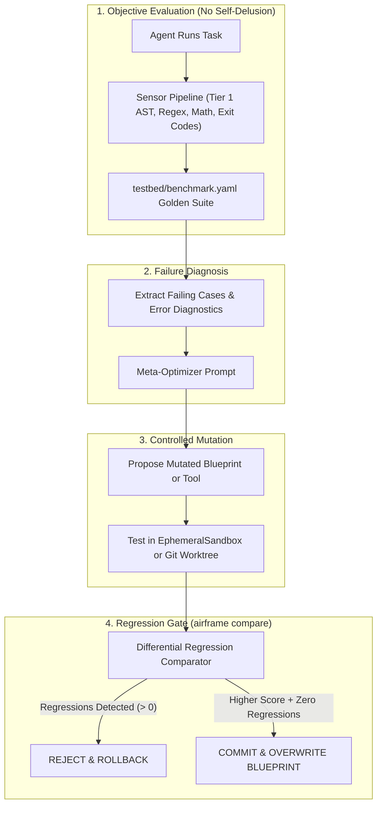

# 🧬 Building Self-Improving Agents with Airframe

> **A guide to engineering autonomous agents that iteratively measure, mutate, and safely improve their own prompts, tools, and workflows without regressions.**

---

## 1. The Core Problem: Why Naive Self-Improvement Fails

Most attempts at building "self-improving" LLM agents collapse due to two fatal flaws:

1. **Self-Delusion (Contextual Bias):** When a model evaluates its own reasoning or code, it almost always grades itself favorably (*"Looks great to me!"*) because it shares the same underlying contextual assumptions.
2. **Catastrophic Regression (Prompt Drift):** An agent mutates its system prompt to fix Problem A, but secretly breaks Problems B, C, and D. Without a regression harness, self-improvement quickly turns into self-degradation.

**Airframe solves this by providing the missing infrastructure**: objective sensors, regression gates, physical sandboxing, and circuit breakers.

---

## 2. The 4 Foundations of Self-Improvement in Airframe

Airframe provides five decoupled subsystems that turn raw LLM generation into an evolutionary learning loop:



1. **Deterministic Truth Grounding (`SensorPipeline`):** Non-LLM sensors (syntax parsers, typecheckers, mathematical verifiers, and unit tests) provide an immutable reality check. An agent cannot "persuade" a compiler or math sensor.
2. **Independent Evaluator-Optimizer (`EvaluatorOptimizerLoop`):** Separates the *Generator* from an independent *Critic*, breaking self-evaluation bias.
3. **Differential Regression Guard (`airframe compare`):** Any proposed improvement to a prompt, tool, or blueprint is automatically benchmarked against a golden baseline suite (`testbed/benchmark.yaml`). If even one regression is detected, the mutation is automatically rejected.
4. **Physical Sandboxing (`EphemeralSandbox` & `WorktreeManager`):** If an agent writes or modifies Python tools, the code is executed in an isolated temporary directory or Git worktree. If the code crashes or has syntax errors, it is discarded without touching production files.
5. **Governance Circuit Breakers (`BudgetTracker`, `RecursionLimiter`):** Hard financial limits ($USD), token ceilings, and max recursion depth prevent infinite runaway self-modification loops.

---

## 3. The 4 Maturity Levels of Self-Improvement

### Level 1: Intra-Task Self-Repair (Active Runtime)
* **Mechanism:** When output violates a Pydantic schema or fails Tier 1 sensors, the harness catches the error and feeds the exact trace back to the model in a targeted repair prompt.
* **Airframe Primitives:** `ExecutableGuard[T]`, `invoke_contract(max_retries=2)`.

### Level 2: Cross-Task Experiential Memory (Playbooks)
* **Mechanism:** When an agent encounters an edge case or failure during execution, it writes the diagnosis into `progress.log` or a `playbook.md` memory file on disk.
* **Airframe Primitives:** `DiskStateManager.append_progress_log()`, `ShiftTurnoverEngine.bootload_shift_prompt()`. Future sessions bootload these historical lessons automatically.

### Level 3: Automated Prompt Optimization (DSPy / OPRO Style)
* **Mechanism:** A Meta-Optimizer agent reads failed benchmark cases, analyzes the failure pattern, and rewrites the target agent's `system_prompt`.
* **Airframe Primitives:** `AgentBlueprint`, `compare_scorecards()`, `DifferentialReport`.
* **The Rule:** Overwrite the blueprint on disk **only** if:
  $$\text{PassRate}_{\text{candidate}} > \text{PassRate}_{\text{baseline}} \quad \text{AND} \quad \text{Regressions} = 0$$

### Level 4: Dynamic Tool Synthesis
* **Mechanism:** The agent detects a recurring capability gap (e.g. inability to compute complex date arithmetic), generates a new Python tool function, validates it in an `EphemeralSandbox`, and registers it via `AgentRegistry.register(overwrite=True)`.

---

## 4. Complete Code Example: An Automated Blueprint Optimizer

Here is a working implementation pattern using Airframe's built-in modules:

```python
import asyncio
from pathlib import Path
from airframe.blueprints import AgentBlueprint
from airframe.telemetry.diff import CaseResult, RunScorecard, compare_scorecards
from airframe.adapters import get_adapter

async def optimize_agent_blueprint(
    blueprint_path: str,
    testbed_cases: list[dict],
    evaluator_fn,
) -> bool:
    """Safely and autonomously improves an agent's prompt using regression gates."""
    
    # 1. Load active blueprint
    active_bp = AgentBlueprint.load_file(blueprint_path)
    optimizer_engine = get_adapter("gemini", "gemini-2.0-flash")
    
    # 2. Benchmark baseline performance on golden testbed
    base_results = await evaluate_testbed(active_bp, testbed_cases, evaluator_fn)
    baseline_scorecard = RunScorecard.from_results(active_bp.engine_binding, base_results)
    
    # 3. Check for failures
    failed_cases = [r for r in base_results if not r.passed]
    if not failed_cases:
        print(f"Agent '{active_bp.name}' already has a 100% pass rate. No optimization needed.")
        return False
        
    print(f"Baseline Score: {baseline_scorecard.passed_cases}/{baseline_scorecard.total_cases} passed.")
    print(f"Analyzing {len(failed_cases)} failures for prompt optimization...")

    # 4. Meta-Optimizer diagnoses errors and generates an improved system prompt
    critique_prompt = f"""
    You are a prompt engineering compiler. The agent '{active_bp.name}' has failed the following tests:
    {failed_cases}

    Current System Prompt:
    \"\"\"{active_bp.system_prompt}\"\"\"

    Analyze the failure root causes. Output an improved, concise system prompt that corrects these 
    failures while preserving existing capabilities. Return ONLY the new system prompt text.
    """
    
    resp = await optimizer_engine.invoke(critique_prompt)
    mutated_prompt = resp.content.strip()

    # 5. Create Candidate Blueprint with mutated prompt
    candidate_bp = active_bp.model_copy(update={"system_prompt": mutated_prompt})

    # 6. Benchmark Candidate on the EXACT same testbed
    cand_results = await evaluate_testbed(candidate_bp, testbed_cases, evaluator_fn)
    candidate_scorecard = RunScorecard.from_results(candidate_bp.engine_binding, cand_results)

    # 7. Run Airframe Differential Regression Comparator
    diff = compare_scorecards(baseline_scorecard, candidate_scorecard)
    print(diff.render_markdown())

    # 8. GOVERNANCE RULE: Accept mutation ONLY if pass rate improved AND zero regressions exist
    if not diff.has_regressions and diff.candidate.passed_cases > diff.baseline.passed_cases:
        print(f"🎉 Improvement Verified! (+{len(diff.improvements)} tests fixed, 0 regressions).")
        # Persist improved blueprint back to disk
        Path(blueprint_path).write_text(candidate_bp.to_yaml(), encoding="utf-8")
        return True
    else:
        print("❌ Mutation Rejected: Caused regressions or failed to improve overall score.")
        return False
```

---

## 5. Architectural Checklist for Self-Improving Agents

Before deploying self-improving agents, ensure these safety constraints are active:

* [ ] **Ground Truth Sensor**: Is output evaluated by code (AST/linters/math/exit codes) rather than model self-evaluation?
* [ ] **Golden Benchmark Dataset**: Do you have at least 10–50 verified test cases in `testbed/benchmark.yaml`?
* [ ] **Zero-Tolerance Regression Gate**: Does the promotion logic reject any mutation that causes `len(diff.regressions) > 0`?
* [ ] **Token/Spend Ceilings**: Is `BudgetTracker` configured with a maximum dollar ceiling ($USD) to prevent runaway optimization loops?
* [ ] **Worktree/Sandbox Isolation**: Are any synthesized tools executed in an `EphemeralSandbox` before being added to production registries?
