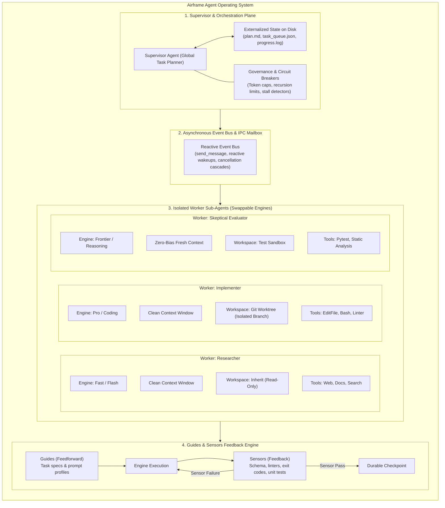

# Airframe Architecture & Requirements Specification

> **The engineering chassis and operating system for reliable, long-horizon AI agents and swappable model engines.**

$$\text{Agent} = \text{Engine (Model)} + \text{Airframe (Harness)}$$

---

## 1. Architectural Principles

1. **Guides Before, Sensors After:** Steer agents upfront with lean guides; enforce correctness after execution with deterministic sensors. Never overload prompts with checks code can enforce.
2. **Executable Guards Over Prose Rules:** Probabilistic prose yields to Pydantic v2 schemas, automated self-repair loops, byte/token ceilings, and OS-level isolation.
3. **Dual-Layer Isolation:** Context window partitioning (`transcript.jsonl` shielded summaries) plus filesystem isolation via Git worktrees and ephemeral sandboxes.
4. **Filesystem as Durable Memory:** Externalized disk state (`plan.md`, `task_queue.json`, `progress.log`) supports multi-shift execution without context rot.
5. **Decentralized Verification:** Independent Evaluator sub-agents and Tier-1 sensors eliminate self-evaluation bias.
6. **Self-Contained Workflow Packs:** Domain packs live isolated under `workflows/<use-case>/` without modifying runner core code.

---

## 2. Functional Requirements & Verification Matrix

### Core Engine, Contracts & Evaluation

#### FR-1: Unified Model Adapter Gateway (Swappable Engines)
- [x] Abstract `ModelAdapter` defining `invoke` and `invoke_contract` (`src/airframe/adapters/base.py`, verified in `tests/unit/test_adapters.py`).
- [x] Provider implementations for Gemini, Anthropic, OpenAI-compatible/Ollama (`src/airframe/adapters/`, verified offline in `tests/unit/test_adapters.py`; opt-in live checks in `tests/live/test_live_adapters.py`).
- [x] Jinja2 `PromptProfiler` (`src/airframe/adapters/profiler.py`, verified in `tests/unit/test_adapters.py`).

#### FR-2: Executable Guards & Schema Self-Repair
- [x] Pydantic v2 `ExecutableGuard`, `SchemaSensor`, byte/line ceilings (`PayloadBounds`), and automated `run_with_retry` self-repair (`src/airframe/guards/executable.py`, `src/airframe/sensors/schema.py`, verified in `tests/unit/test_guards_and_sensors.py` & `tests/unit/test_adapters.py`).

#### FR-3: Multi-Tier Sensor Pipeline
- [x] **Tier 1 (Deterministic):** `SchemaSensor`, `PythonASTSensor`, `RegexSensor`, `KeywordSensor`, `ExitCodeSensor` (`src/airframe/sensors/`, verified in `tests/unit/test_guards_and_sensors.py`), plus pack discovery (`WorkflowPack.load_sensors`, verified in `tests/unit/test_workflows_and_diff.py` & `tests/unit/test_cli.py`).
- [x] **Tier 2 (Semantic & Tool):** `ToolCallValidatorSensor` and `TokenOverlapSensor` (token Jaccard overlap, `src/airframe/sensors/tier2_semantic.py`, verified in `tests/unit/test_guards_and_sensors.py` & `tests/unit/test_tools.py`).
- [x] **Tier 3 (LLM Judge):** `ModelJudgeSensor` with `JudgeRubric` and Tier-1 short-circuiting (`src/airframe/sensors/tier3_judge.py`, verified in `tests/unit/test_guards_and_sensors.py`).

#### FR-4: Dynamic Tool Scoping & Context Diet
- [x] Zero-decorator `ToolRegistry`, `ScopedToolInjector(max_tools_per_phase=5)`, `ToolRunner`, and `ContextBudgeter` (`src/airframe/tools/`, verified in `tests/unit/test_tools.py` & `tests/integration/test_runtime_runner.py`).

#### FR-5: Differential Regression & Baseline Diffing
- [x] `RunScorecard`, Markdown/JSON diff reports, and `airframe compare` zero-regression gate (`src/airframe/telemetry/diff.py`, `src/airframe/cli.py`, verified in `tests/unit/test_workflows_and_diff.py` & `tests/unit/test_java_jwt_triage.py`).

### Multi-Agent Systems, Long Horizons & Isolation

#### FR-8: Dynamic Agent Registry & Blueprint Engine
- [x] `AgentBlueprint`, `AgentRegistry`, strict `entrypoint_agent` resolution, and lifecycle state machine (`src/airframe/blueprints/`, `src/airframe/ipc/lifecycle.py`, verified in `tests/unit/test_blueprints.py`, `tests/unit/test_orchestration.py`, & `tests/unit/test_cli.py`).

#### FR-9: Dual-Layer Isolation Engine
- [x] **Context Isolation:** `ContextPartitioner` (`fsync` JSONL transcripts, `.corrupt_tail` recovery, `CompressedHandoff` in `src/airframe/isolation/context.py`, verified in `tests/unit/test_isolation.py`).
- [x] **Workspace Isolation:** `get_workspace(mode=...)` supporting `"inherit"`, `"branch"` (`WorktreeManager` with `.registry.lock`, `WorktreeConflictError`, deterministic `get_diff()`, `SIGKILL` orphan reaper, signal cleanup), and `"sandbox"` (`EphemeralSandbox`), verified in `tests/unit/test_isolation.py` & `tests/integration/test_system_integration.py`.
- [ ] **Container Isolation (`workspace_mode="container"`):** **Deferred (per [ADR 0001](adr/0001-workflow-vs-container-isolation.md))**.

#### FR-10: Orchestration Topologies
- [x] **`orchestrator-workers`:** `SupervisorAgent` + `WorkflowRunner._run_orchestrator_workers()` (`tests/unit/test_orchestration.py`, `tests/integration/test_system_integration.py`, `tests/integration/test_runtime_runner.py`).
- [x] **`evaluator-optimizer`:** `EvaluatorOptimizerLoop` + `WorkflowRunner._run_evaluator_optimizer()` (`tests/unit/test_orchestration.py`, `tests/integration/test_runtime_runner.py`).
- [ ] **`router` topology:** **Not Implemented**.

#### FR-11: Long-Horizon Persistence & Multi-Shift Durability
- [x] `DiskStateManager` (`atomic_write_text`, re-entrant `fcntl.flock`, `.bak` recovery) and `ShiftTurnoverEngine` with git checkpoint commits wired into `WorkflowRunner` (`src/airframe/state/disk.py`, `src/airframe/orchestration/shift.py`, verified in `tests/unit/test_long_horizon_and_governance.py` & `tests/integration/test_runtime_runner.py`).

#### FR-12: Reactive IPC & Cancellation Cascades
- [x] `EventBus` / `AgentMessage` (`asyncio.Queue` reactive wakeup) and `LifecycleManager.cancel_cascade()` (`src/airframe/ipc/`, verified in `tests/unit/test_orchestration.py`).

#### FR-13: Governance, Circuit Breakers & Budget Caps
- [x] `RecursionLimiter`, `BudgetTracker`, `MaxTurnsExceededError`, `asyncio.wait_for` timeout, `StallDetector`, and `HumanApprovalGate` (`src/airframe/governance/`, verified in `tests/unit/test_long_horizon_and_governance.py`, `tests/unit/test_tools.py`, & `tests/integration/test_runtime_runner.py`).

#### FR-14: Hierarchical Observability & Distributed Tracing
- [x] W3C-compatible `AirframeTracer`, `contextvars` parent propagation, `build_trace_tree()`, optional OpenTelemetry mirror, and `airframe trace` CLI (`src/airframe/telemetry/tracer.py`, `src/airframe/cli.py`, verified in `tests/unit/test_telemetry_tracer.py`, `tests/unit/test_showcase_workflows.py`, & `tests/integration/test_runtime_runner.py`).

### Workflow Packaging & CLI

#### FR-15: Self-Contained Workflow Packs & CLI
- [x] `WorkflowManifest`, `WorkflowPack.load_tools()`, `WorkflowPack.load_sensors()`, and packs under `workflows/` (`pr-reviewer`, `basic-calculator`, `calculator`, `weather-forecaster`, `java-jwt-triage`, `patch-verifier`, `code-auditor-swarm`).
- [x] `airframe run`, `airframe test`, `airframe compare`, `airframe trace`, and `airframe init workflow` (`src/airframe/cli.py`, verified in `tests/unit/test_cli.py`, `tests/unit/test_workflows_and_diff.py`, `tests/unit/test_weather_forecaster.py`, & `tests/unit/test_showcase_workflows.py`).

---

## 3. Non-Functional Requirements (NFR)

* **NFR-1 (Determinism & Zero Flakes):** Tier-1 sensors are 100% deterministic; LLM judges enforce fixed seeds and `temperature=0.0`.
* **NFR-2 (Strict Isolation):** Model quirks, headers, and vendor errors remain encapsulated behind `ModelAdapter`.
* **NFR-3 (Extensibility):** New adapters, sensors, tools, and workspaces plug in without modifying runner internals (see [EXTENDING.md](EXTENDING.md)).
* **NFR-4 (Security & Cleanup):** Credentials come strictly from environment variables; worktrees, temp sandboxes, and child processes clean up across normal exits and signal crashes.
