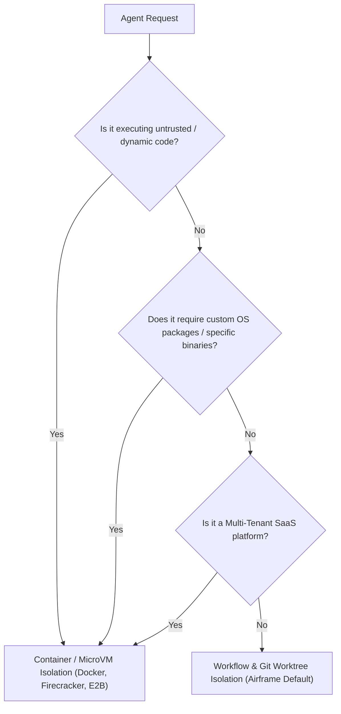

# ADR 0001: Workflow-Level Isolation vs. Container-Based Isolation

* **Status:** Accepted
* **Date:** 2026-11-06
* **Deciders:** Core Engineering Team
* **Tags:** `architecture`, `isolation`, `sandboxing`, `workflows`, `containers`, `security`

---

## 1. Context & Problem Statement

AI agent frameworks must provide execution isolation to prevent agents from polluting shared state, corrupting context windows, or conflicting during parallel task execution.

As **Airframe** evolves as an Agent Operating System supporting swappable models, evaluator-optimizer loops, and multi-agent topologies (e.g., Supervisors and Workers), we face a foundational architectural choice:

> **Should Airframe isolate agents using lightweight process/filesystem workflows (Git worktrees, ephemeral directories) or via heavy OS-level containers (Docker, Podman, MicroVMs)?**

We need to balance:
1. **Developer Experience (DX) & Portability:** Running locally on bare metal without requiring background daemons (Docker Desktop/Podman) or root privileges.
2. **Execution Latency:** Fast feedback loops during automated self-repair (`invoke_contract` retries, sensor pipeline passes).
3. **Worker Concurrency & Density:** Enabling parallel worker fleets on developer machines.
4. **Security & Blast Radius:** Protecting host environments from buggy or unconstrained agent actions.

---

## 2. Options Considered

### Option 1: Full Container-per-Agent Isolation (Docker / OCI)
Every agent turn or worker sub-process spins up an ephemeral OCI container with its own filesystem, PID namespace, and network sandbox.

* **Pros:**
  * Maximum security isolation: strict boundaries around host files, network, and system processes.
  * Deterministic dependencies: completely hermetic OS environment with bundled tools.
  * Strict cgroup quotas (CPU, RAM ceilings).
* **Cons:**
  * **Severe startup latency:** 500ms to 5+ seconds per container spin-up (image layer mounts, cgroup allocation, container daemon overhead). Destroys sub-second feedback loops.
  * **High host footprint:** Limits parallel worker concurrency on developer laptops (e.g., spawning 20 parallel workers requires gigabytes of container runtime overhead).
  * **Operational friction:** Requires Docker/container engine installation, volume mounting gymnastics, and Docker-in-Docker (`dind`) complexities in CI.
  * **Awkward state handoffs:** Inter-agent communication and Git diff extraction require volume syncing or object stores.

---

### Option 2: Lightweight Workflow & Git Worktree Isolation (Selected Baseline)
Agents execute as standard in-process or sub-processes on the host, isolated physically via Git Worktrees (`WorktreeManager`), ephemeral directories (`EphemeralSandbox`), and context partitioners (`ContextPartitioner`).

* **Pros:**
  * **Near-instantaneous startup:** Sub-millisecond directory creation and ~20–50ms `git worktree add`.
  * **High concurrency & density:** Negligible memory overhead; easily runs 50+ isolated workers concurrently.
  * **Zero operational prerequisites:** Runs directly in any Python 3.10+ environment without Docker daemons, root rights, or background services.
  * **Native Git primitives:** Perfect alignment with code-centric tasks (atomic branch creation, `git diff HEAD~1..HEAD`, pull request generation).
  * **Rapid evaluation cycles:** Evaluator-Optimizer self-repair loops iterate in milliseconds rather than seconds.
* **Cons:**
  * **Shared kernel and user permissions:** Agent code runs with the permissions of the invoking user.
  * **Not hermetic:** Relies on tools and libraries installed on the host machine.
  * **Unsafe for untrusted execution:** Vulnerable if an agent executes arbitrary destructive shell commands (`rm -rf ~`) or malicious code.

---

### Option 3: MicroVM Isolation (Firecracker / gVisor)
Use lightweight hardware-virtualized MicroVMs (such as AWS Firecracker or Kata Containers) for each sub-agent.

* **Pros:**
  * Hardware-level virtualization with fast startup (~150ms).
  * Safe multi-tenant boundary.
* **Cons:**
  * Requires Linux KVM virtualization support; cannot run natively on macOS without virtualization layers.
  * Prohibitive setup overhead for local developer machines.

---

### Option 4: Layered Hybrid Strategy (Future Target)
Choreography and trusted workflows remain host/worktree-based, while untrusted code execution tasks are dispatched into pluggable container/microVM providers.

* **Pros:** Combines the sub-second speed of workflows with the zero-trust safety of containers where needed.

---

## 3. Decision

We choose **Option 2 (Lightweight Workflow & Git Worktree Isolation)** as the standard default architecture for Airframe, while structuring the workspace engine around a pluggable factory pattern (`WorkspaceStrategy` / `get_workspace()`) to enable **Option 4 (Layered Hybrid)** as an opt-in extension.

### Core Architectural Choices in Effect:
1. **Filesystem Isolation:** Managed via `WorktreeWorkspace` (isolated Git worktrees on dedicated ephemeral branches) and `SandboxWorkspace` (temporary scratchpad directories).
2. **Context Window Isolation:** Managed via `ContextPartitioner` and `CompressedHandoff`, stripping exploratory token noise from the supervisor's context.
3. **Crash Compensation & Safety:** Guaranteed via `reap_stale_worktrees()`, idempotent collision reclaim, transactional rollback, and crash-safe atomic disk state (`DiskStateManager`).

---

## 4. Why We Chose Workflow-Level Isolation for Now

1. **Self-Repair Loops Require Sub-Second Velocity:**
   Airframe's core value proposition is the **multi-tier sensor pipeline and executable contract self-repair** (`FeedbackLoop` / `run_with_retry`). If an agent fails a Tier 1 AST sensor or Pydantic validation error, the correction loop must iterate in under 100 milliseconds. Container spin-up overhead (3–5 seconds) destroys the interactive agent feedback loop.
2. **Native Git Alignment for Code Tasks:**
   Most engineering workflows (e.g., `workflows/pr-reviewer`, code refactoring, test generation) operate on Git repositories. Git worktrees offer atomic checkout, branch isolation, and native diff generation out of the box, avoiding redundant file sync layers between host and container.
3. **Zero Developer Friction:**
   Developers can clone Airframe, run `pip install -e ".[dev]"`, and immediately execute `airframe run` or `airframe test` without troubleshooting Docker Desktop, socket permissions, or image pull latencies.
4. **Machine Density:**
   Multi-agent topologies (e.g. 1 Supervisor + 8 parallel Workers) can run effortlessly on modest developer hardware without exhausting RAM or CPU quotas.

---

## 5. When Container Isolation Starts Making Sense (The Tipping Points)

Container or MicroVM isolation must be introduced when any of the following architectural thresholds are reached:



### Specific Trigger Conditions:

| Threshold / Trigger | Description | Target Container Primitive |
| :--- | :--- | :--- |
| **1. Untrusted Code Execution (Level 4 Self-Improvement)** | When an agent moves from *proposing/editing* code to *executing arbitrary generated Python/Bash scripts* (e.g. running generated tests or synthetic tools). | Ephemeral Docker container or gVisor sandbox with no network and read-only host mounts. |
| **2. Multi-Tenant Hosted SaaS** | When Airframe is deployed as a multi-user service where agents execute workloads submitted by arbitrary external users. | Firecracker MicroVMs or isolated Kubernetes jobs per tenant. |
| **3. Complex OS / System Dependencies** | When a workflow pack requires system packages not present on standard developer machines (e.g., FFmpeg, Headless Chromium, Poppler, specialized C compilers). | Pre-built container images referenced in `workflow.yaml`. |
| **4. Strict Resource & Egress Quotas** | When tasks require hard physical constraints (e.g. hard cap of 512MB RAM, timeout kill at the OS level, or blocking all outbound network traffic). | Docker cgroup limits (`--memory`, `--cpus`, `--network none`). |

---

## 6. Implementation & Evolution Roadmap

Airframe's workspace dispatcher already supports this evolution cleanly:

```python
# src/airframe/isolation/workspace.py
workspace = get_workspace(mode=blueprint.workspace_mode, ...)
```

* **Current modes:**
  * `"inherit"` $\rightarrow$ `SharedWorkspace` (in-place repo execution)
  * `"branch"` $\rightarrow$ `WorktreeWorkspace` (isolated Git worktree with crash compensation)
  * `"sandbox"` $\rightarrow$ `SandboxWorkspace` (ephemeral temporary directory)
* **Future extension (Planned Phase 7):**
  * `"container"` $\rightarrow$ `ContainerWorkspace` (ephemeral container mount using local Docker/Podman or remote sandbox API such as E2B/Modal).

---

## 7. Consequences

### Positive
* Zero runtime dependencies beyond Python and Git.
* Blazing fast CLI execution (`airframe test` and `airframe compare` run in milliseconds).
* Low barrier to entry for open-source contributors and local testing.
* Robust crash compensation (`reap_stale_worktrees`, atomic fsync state) mitigates the lack of container boundaries.

### Negative / Tradeoffs
* Users must remain aware that agents running shell commands locally run with the permissions of the host user.
* Host environment pollution is possible if an agent writes outside its designated worktree or workspace directory. (Mitigated by Tier 1 Regex sensors blocking sensitive paths and human-in-the-loop approval gates).
