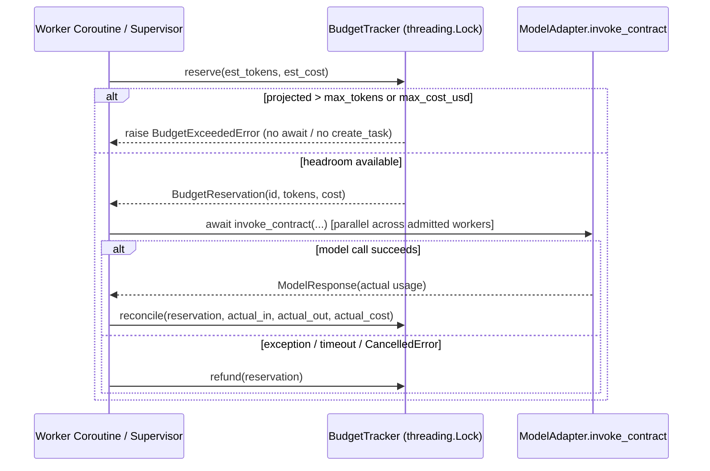

# ADR 0002: Budget Gate Concurrency Model — In-Process Atomic Reservation vs. Cross-Process & Lock-File Accounting

* **Status:** Accepted
* **Date:** 2026-11-11
* **Deciders:** Core Engineering Team
* **Tags:** `architecture`, `governance`, `concurrency`, `budget`, `toctou`, `orchestration`
* **Related:** [ADR 0001](0001-workflow-vs-container-isolation.md), [`src/airframe/governance/circuit_breakers.py`](../../src/airframe/governance/circuit_breakers.py), [`tests/unit/test_budget_concurrency.py`](../../tests/unit/test_budget_concurrency.py)

---

## 1. Context & Problem Statement

In Phase 1 of Airframe's correctness gates, [`tests/unit/test_budget_concurrency.py`](../../tests/unit/test_budget_concurrency.py) proved a Time-of-Check to Time-of-Use (**TOCTOU**) concurrency hazard in budget enforcement:

* `BudgetTracker` previously offered only `record_usage(input_tokens, output_tokens, cost_usd)`, invoked **post-hoc** after `await adapter.invoke_contract(...)` returned.
* When $N$ concurrent async workers share one `BudgetTracker` with a tight ceiling (e.g., 6 workers racing on a 100-token cap at 80 tokens/call), every coroutine observes unexhausted committed totals before hitting `await`, dispatches all $N$ model calls in parallel, and overshoots the budget $N$-fold ($480 > 100$) before `BudgetExceededError` finally fires too late.
* Similarly, `SupervisorAgent.delegate_subtask` (`src/airframe/orchestration/supervisor.py`) previously spawned child coroutines with `asyncio.create_task(runner(subtask))` without gating task creation against remaining budget headroom or reclaiming leaked reservations when tasks fail or cancel.

This forces an explicit architectural decision on Airframe's worker execution model and budget synchronization primitive:

> **What worker execution boundary does Airframe's runtime target today (in-process vs. cross-process), and how must `BudgetTracker` synchronize concurrent admission (in-process atomic reservation ledger vs. OS advisory lock files vs. an external quota service)?**

---

## 2. Execution Topology Analysis: In-Process vs. Cross-Process Workers

Inspecting Airframe's runtime components clarifies the exact boundary of shared execution today:

| Component | Module | Execution Primitive | Shared State Scope |
| :--- | :--- | :--- | :--- |
| **`WorkflowRunner`** | `src/airframe/runner/engine.py` | Single `BudgetTracker` per `run()` | Single Python process (coroutine tasks) |
| **`SupervisorAgent`** | `src/airframe/orchestration/supervisor.py` | `asyncio.create_task(runner(subtask))` | Single event loop / process |
| **`EventBus` & `LifecycleManager`** | `src/airframe/ipc/{bus,lifecycle}.py` | In-memory `asyncio.Queue` & `asyncio.Task` registry | Single Python process |
| **`DiskStateManager` & `WorktreeManager`** | `src/airframe/state/disk.py`, `src/airframe/isolation/worktree.py` | `fcntl.flock` + `fsync` JSON/markdown files | Cross-process crash durability on disk |

Airframe's model calls, tool loops, and supervisor/worker delegation execute under an **In-Process Worker Model**: workers are concurrent `asyncio` tasks (and optionally worker threads sharing one `BudgetTracker` instance) living inside a single host OS process. Cross-process OS workers communicating over sockets or containers (cf. ADR 0001 `"container"` mode) are not yet spawned by `WorkflowRunner` or `SupervisorAgent`.

---

## 3. Options Considered

### Option 1: Post-Hoc Accounting Only (`record_usage` After Completion) — *Rejected*
Commit token and dollar totals only after an LLM invocation finishes.

* **Why rejected:** Disproved by Phase 1's TOCTOU test. Permits arbitrary $N$-fold overshoot bounded only by concurrency fan-out.

### Option 2: Advisory Lock Files (`fcntl.flock` Around Budget Reads/Writes) — *Rejected*
Persist budget state to a temporary file protected by POSIX `fcntl.flock` before/after model calls.

* **Cons:**
  * **Wrong abstraction for in-process coroutines:** Holding an `flock` across `await adapter.invoke_contract(...)` would block OS threads inside an async event loop and serialize parallel workers behind every slow HTTP round-trip; releasing the lock before `await` without a reservation ledger does not close the TOCTOU race at all.
  * **Unnecessary filesystem overhead & failure modes:** Adds file-descriptor creation, temp-directory lifecycle, and stale-lock cleanup onto pure in-memory unit runs and high-frequency LLM dispatch paths, and behaves inconsistently across Windows/virtualized filesystems.
  * `fcntl.flock` in Airframe is reserved strictly for durable disk artifacts (`DiskStateManager`, `WorktreeManager`) where cross-process file mutation actually occurs.

### Option 3: In-Process Atomic Reservation Ledger (`threading.Lock` + `reserve` / `reconcile` / `refund` / `release`) — *Selected*
Model budget accounting as a two-phase in-memory ledger protected by a short-lived `threading.Lock`:

1. **Debit Reserve (Pre-Flight Admission):** Before spawning a worker (`asyncio.create_task`) or invoking a model (`await adapter.invoke_contract(...)`), atomically check `(committed + reserved + requested) <= ceiling` and create a unique `BudgetReservation` hold.
2. **Preserve Async Parallelism:** `BudgetTracker._lock` protects only microsecond-scale in-memory arithmetic and dict updates — it is **never held across `await`**. Up to $K$ workers that legitimately fit inside remaining budget still execute in parallel.
3. **Reconcile on Completion:** When `await adapter.invoke_contract(...)` succeeds, atomically remove the reservation hold, commit actual `input_tokens`, `output_tokens`, and `cost_usd`, and validate actual ceilings.
4. **Refund / Release on Failure or Cancellation:** In `except BaseException:` / `finally:` guards, release unspent reservations back to the pool so failed retries, timeouts, or cancelled subtasks never leak phantom "ghost debt."

* **Pros:** Zero disk I/O latency, works across both single-event-loop `asyncio` tasks and multi-threaded `ThreadPoolExecutor` harnesses, zero new runtime dependencies, and deterministic in-flight admission bounds.
* **Cons:** Enforces ceilings within a single OS process only; independent OS processes running separate `BudgetTracker` instances do not see each other's holds.

### Option 4: External Transactional Quota Service (SQLite WAL / Redis / HTTP Lease Server) — *Deferred*
Back `BudgetTracker` with an external transactional store using TTL leases.

* **Why deferred:** Adds operational setup friction and latency disproportionate to Airframe's current single-process workflow runner (violating ADR 0001's zero-daemon developer experience baseline until multi-process runners exist).

---

## 4. Decision & System Invariants

We adopt **Option 3: In-Process Worker Model with an Atomic Pre-Flight Reservation Ledger** (`BudgetTracker.reserve`, `reconcile`, `refund`, `release`), **not budget lock files**.

### Mandatory Runtime Invariants

1. **Process Scope Guarantee:** A `BudgetTracker` instance enforces tight token and USD ceilings deterministically across all concurrent `asyncio` tasks and OS threads inside one Airframe process.
2. **Pre-Flight Check-and-Debit:** Every model dispatch path in `WorkflowRunner` (single-agent direct, single-agent multi-turn ReAct, orchestrator planning, orchestrator synthesis) MUST `reserve()` before `await adapter.invoke_contract(...)`.
3. **Pre-Spawn Supervisor Guard:** `SupervisorAgent.delegate_subtask` MUST `reserve()` before calling `asyncio.create_task(...)` and MUST `release()` the reservation inside an unconditional `finally:` block across success, exception, and cancellation. `BudgetExceededError` must propagate rather than being coerced into a silent `FAILED` handoff.
4. **Never Hold Locks Across `await`:** `BudgetTracker._lock` must remain strictly synchronous and non-blocking so unrelated async tasks cannot deadlock on an awaited coroutine holding the lock.
5. **Conservative Pre-Flight Token Floor:** Pre-flight estimation charges `max(min_output_floor, estimated_prompt_tokens + min_output_floor)` so tight token ceilings prevent excessive concurrent dispatches even before response token counts are known, while cost estimation tracks observed `cost_usd / total_tokens` rate once committed telemetry exists.

---

## 5. Consequences

### Positive
* Closes the $N$-worker TOCTOU overshoot gate (`test_budget_concurrency.py`) without serializing model HTTP calls or creating filesystem lock files.
* Eliminates silent reservation leaks across failed model calls, timeouts, and cancelled asyncio tasks via idempotent `refund`/`release`.
* Preserves backward compatibility for direct `BudgetTracker.record_usage(...)` unit callers while making all mutations thread-safe.

### Negative / Tradeoffs
* **Single-process boundary:** Two separate CLI invocations or future OS-level worker subprocesses do not share one `BudgetTracker` limit unless a parent coordinator aggregates leases.
* **Cold-start cost opacity:** Before the first model call completes (`total_tokens == 0`), a workflow with a tight `max_cost_usd` ceiling and generous `max_tokens` ceiling relies on fallback cost estimation until the first response establishes an observed cost-per-token rate (unless explicit `estimated_cost_usd` is provided on subtask metadata).

---

## 6. Tipping Points for Cross-Process Budget Coordination

Revisit this ADR and introduce an external transactional lease backend (e.g., SQLite WAL store on local host or Redis/RPC TTL leases across containers/nodes) when any of the following occur:

| Trigger | Concrete Threshold | Migration Path |
| :--- | :--- | :--- |
| **1. Subprocess Worker Pools** | `SupervisorAgent` delegates work across `multiprocessing` / `subprocess` workers that invoke `ModelAdapter` directly. | Extract `BudgetLedger` protocol behind `BudgetTracker`; swap in-process dict for SQLite `BEGIN IMMEDIATE` reservation rows with PID/lease TTL. |
| **2. Containerized Execution (ADR 0001 Phase 7)** | `"container"` workspace agents hold provider credentials directly inside isolated Docker/MicroVM runtimes. | Proxy model calls through a host quota sidecar issuing short-lived `BudgetReservation` leases over IPC/HTTP. |
| **3. Multi-Host / Tenant SaaS Quotas** | Multiple Airframe coordinator replicas serve one shared tenant spending cap. | Back the reservation ledger with Redis Lua atomic scripts or transactional DB leases with expiry reaping. |
