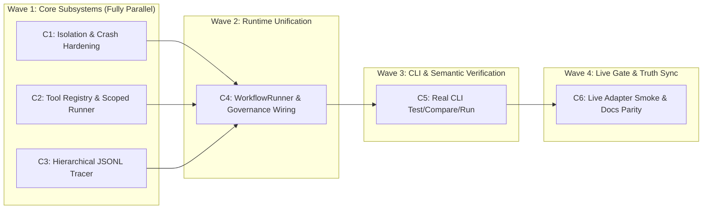

# Gap Remediation & Hardening Specification (Biased & Compartmentalized)

* **Status:** Proposed / Ready for Wave Execution
* **Date:** 2026-11-10
* **Baseline Commit:** `f5eadf1` (`55/55` tests passing)
* **Companion Docs:** [`REQUIREMENTS.md`](../../REQUIREMENTS.md), [`ADR 0001`](../adr/0001-workflow-vs-container-isolation.md)

---

## 1. Philosophy: Biased & Compartmentalized Execution

This specification closes every verified runtime, isolation, governance, tooling, observability, and CLI gap identified against [`REQUIREMENTS.md`](../../REQUIREMENTS.md).

1. **Biased (Opinionated, Zero-Ambiguity Decisions):** Each compartment mandates a single canonical design choice and explicitly forbids alternative patterns or fallback stubs.
2. **Compartmentalized (Zero-Overlap Ownership):** Every compartment (`C1`–`C6`) owns a **strictly disjoint set of files**. Parallel compartments can execute simultaneously in isolated Git worktrees (`WorktreeWorkspace`) with zero merge conflicts.

---

## 2. Execution DAG & Parallel Waves



### Strict Ownership Matrix (Zero Overlapping Write Targets)

| Compartment | Exclusive Write Scope | Read-Only Dependencies |
| :--- | :--- | :--- |
| **`C1`** | `src/airframe/isolation/*`, `tests/unit/test_isolation.py` | `src/airframe/state/disk.py` (`atomic_write_text`) |
| **`C2`** | `src/airframe/tools/*`, `tests/unit/test_tools.py` | `src/airframe/governance/circuit_breakers.py`, `src/airframe/sensors/tier2_semantic.py` |
| **`C3`** | `src/airframe/telemetry/tracer.py`, `src/airframe/telemetry/__init__.py`, `tests/unit/test_telemetry_tracer.py` | Standard library (`contextvars`, `uuid`, `json`) |
| **`C4`** | `src/airframe/runner/*`, `src/airframe/orchestration/supervisor.py`, `src/airframe/orchestration/shift.py`, `tests/integration/test_runtime_runner.py` | Outputs of `C1`, `C2`, `C3`, `src/airframe/adapters/base.py`, `src/airframe/governance/*` |
| **`C5`** | `src/airframe/cli.py`, `src/airframe/workflows/loader.py`, `tests/unit/test_cli.py`, `tests/unit/test_workflows_and_diff.py` | `C4` (`WorkflowRunner`), `C2` (`ToolRegistry`), `src/airframe/sensors/*` |
| **`C6`** | `tests/live/test_live_adapters.py`, `README.md`, `REQUIREMENTS.md`, `IMPLEMENTATION_PLAN.md` | Full test suite (`pytest tests/`) |

---

## 3. Compartment Specifications

---

### Compartment C1: Isolation & Crash-Durability Hardening

* **Gaps Closed:** Worktree registry concurrency race, live-PID clobbering on `agent_id` collision, broken `get_diff()` on uncommitted/single-commit repos, missing `SIGINT`/`SIGTERM` cleanup, non-atomic `ContextPartitioner` writes, and lack of real `SIGKILL` crash tests.
* **Wave:** Wave 1 (Parallel)

#### Biased Technical Decisions
1. **Locked & Synced Registry:** `WorktreeManager` MUST reuse `atomic_write_text` + an `fcntl.flock` lockfile (`.airframe/worktrees/.registry.lock`) around every `_read_registry -> mutate -> _write_registry` critical section. No bespoke unprotected `temp_file.write_text` calls.
2. **Never Clobber Live Siblings:** Introduce `WorktreeConflictError(WorktreeError)`. In `create_worktree()`, if `agent_id` is in the registry and `is_pid_alive(entry["pid"])` is `True` (and `pid != os.getpid()`), **raise `WorktreeConflictError` immediately**. Only reclaim when `is_pid_alive(pid)` is `False` or `force=True`.
3. **Deterministic `base_commit` Diffing:** Record `"base_commit": <resolved SHA of base_ref>` inside `worktree_registry.json` at creation time. Rewrite `get_diff(worktree_dir, base_ref=None)` to diff `base_commit` against the active working tree (`git diff <base_commit>`) plus untracked file listings (`git status --porcelain`), eliminating `HEAD~1..HEAD` breakage on single-commit or multi-commit branches.
4. **Signal + Atexit Compensation:** `WorktreeWorkspace` MUST install `SIGINT` and `SIGTERM` cleanup handlers (chaining cleanly to prior handlers) in addition to `atexit`.
5. **Tail-Tolerant Crash-Safe Transcripts:** `ContextPartitioner.log_turn()` MUST `flush()` + `os.fsync()`. `read_transcript(tolerate_corrupt_tail: bool = True)` quarantines/discards an incomplete final JSONL line from a mid-write crash (appending a `.corrupt_tail` marker), while raising `CorruptedTranscriptError` if corruption occurs in non-terminal lines.

#### Explicit Interfaces
* `src/airframe/isolation/worktree.py`: `WorktreeConflictError`, `WorktreeManager.lock()`, `WorktreeManager.get_diff(worktree_dir, base_ref=None)`
* `src/airframe/isolation/context.py`: `CorruptedTranscriptError`, `ContextPartitioner.read_transcript(tolerate_corrupt_tail: bool = True)`

#### Acceptance & Verification Gates (`tests/unit/test_isolation.py`)
* **Real `SIGKILL` Subprocess Test:** Spawn a Python child process via `subprocess.Popen` that creates a worktree (`agent_id="sigkill-victim"`) and sleeps; send `os.kill(proc.pid, signal.SIGKILL)`; verify `reap_stale_worktrees()` cleans directory, git metadata, and branch.
* **Live-Peer Protection Test:** Spawn a live child process holding `agent_id="active-peer"`; assert a second caller invoking `create_worktree(..., agent_id="active-peer")` raises `WorktreeConflictError`.
* **Concurrent Registry Stress Test:** Run 8 parallel `create_worktree` / `remove_worktree` tasks via `asyncio.gather`; assert zero lost registry entries.
* **Single-Commit & Uncommitted Diff Test:** Assert `get_diff()` returns uncommitted edits and newly committed changes on a 1-commit repo.
* **Truncated Transcript Tail Test:** Append half a JSON line to `transcript.jsonl`; assert `read_transcript()` recovers all prior turns without crashing.

---

### Compartment C2: Tool Registry, Phase Scoping & Sandboxed Runner (`FR-4`)

* **Gaps Closed:** Missing `src/airframe/tools/` package, lack of phase-based tool scoping (`Discovery`/`Execution`/`Verification`), missing context-diet token budgeter, and disconnected workflow `tools.py` files.
* **Wave:** Wave 1 (Parallel)

#### Biased Technical Decisions
1. **Zero-Decorator Function Introspection:** Do **not** require custom decorators on workflow authors' tools. `ToolRegistry.load_from_module(path)` discovers public functions (`not name.startswith("_")`) from `workflows/<pack>/tools.py` using `inspect.signature` + docstrings + `pydantic.create_model` to synthesize validated input schemas. Existing `workflows/basic-calculator/tools.py` and `workflows/weather-forecaster/tools.py` MUST load with zero modifications.
2. **Hard Phase Ceiling (Max 5 Tools):** Define `ToolPhase = Literal["discovery", "execution", "verification"]`. `ScopedToolInjector(max_tools_per_phase: int = 5)` raises `ToolScopeExceededError` if a phase binds more than 5 tools, forcing lean context diets.
3. **Mandatory Governance Hooks in `ToolRunner`:** Every tool invocation passes through:
   * `ToolCallValidatorSensor` (whitelist + required arguments check)
   * `HumanApprovalGate` (for shell/destructive patterns; blocks unless `approval_callback` returns `True`)
   * `StallDetector` (hashes `tool_name + canonical_args_json`; trips `StallDetectedError` after `stall_threshold` consecutive identical failures)
4. **Context Diet Budgeter (`ContextBudgeter`):** Estimates guide/prompt token footprint (`len(text) // 4` or configured tokenizer) and emits structured warnings (`ContextDietWarning`) or raises `ContextBudgetExceededError` in strict mode when guides exceed `max_guide_tokens` (default: `4000`).

#### Explicit Interfaces
* `src/airframe/tools/registry.py`: `ToolSpec(BaseModel)`, `ToolRegistry` (`register`, `load_from_file`, `get`, `to_prompt_schema`)
* `src/airframe/tools/scoper.py`: `ToolPhase`, `ToolScopeExceededError`, `ScopedToolInjector`, `ContextBudgeter`
* `src/airframe/tools/runner.py`: `ToolExecutionResult(BaseModel)`, `ToolRunner` (`execute(tool_name, arguments, allowed_tools=...)`)

#### Acceptance & Verification Gates (`tests/unit/test_tools.py`)
* Load real functions from `workflows/basic-calculator/tools.py` and `workflows/weather-forecaster/tools.py`; execute both sync (`calculate`) and async (`geocode_location` via `MockTransport` or monkeypatch) functions through `ToolRunner` with Pydantic argument coercion.
* Assert `ScopedToolInjector` raises `ToolScopeExceededError` when 6 tools are assigned to `"execution"`.
* Assert `ToolRunner` blocks an unapproved destructive tool payload via `HumanApprovalGate` (`ApprovalRejectedError`) and trips `StallDetector` on 3 repeated failing invocations.

---

### Compartment C3: Hierarchical Observability & Trace Trees (`FR-14`)

* **Gaps Closed:** Missing hierarchical span trees linking `Root -> Supervisor -> Worker -> Tool -> Sensor` and missing run replay artifacts.
* **Wave:** Wave 1 (Parallel)

#### Biased Technical Decisions
1. **Zero Mandatory External Dependencies:** Do **not** add `opentelemetry-sdk` as a required dependency in `pyproject.toml`. Build a lightweight, W3C-compatible native tracer (`AirframeTracer`) using `contextvars.ContextVar` for automatic parent-child propagation across `asyncio` coroutines and `asyncio.create_task`.
2. **Durable JSONL Span Stream:** Write spans line-by-line (`flush()` + `os.fsync()`) to `.airframe/traces/<trace_id>.jsonl`. Each `SpanRecord` carries `trace_id` (32-hex), `span_id` (16-hex), `parent_span_id`, `name`, `kind` (`"root" | "supervisor" | "worker" | "model" | "tool" | "sensor"`), `start_ns`, `end_ns`, `status`, and `attributes`.
3. **Optional OTel Bridge:** If `opentelemetry.trace` is importable in the environment, forward span start/end events to the active OpenTelemetry tracer as a non-fatal best-effort mirror.

#### Explicit Interfaces
* `src/airframe/telemetry/tracer.py`: `SpanKind`, `SpanRecord(BaseModel)`, `AirframeTracer` (sync/async context manager `start_span(name, kind, attributes=...)`), `load_trace(trace_path) -> list[SpanRecord]`, `build_trace_tree(spans) -> dict`

#### Acceptance & Verification Gates (`tests/unit/test_telemetry_tracer.py`)
* Run nested async tasks (`Root -> Supervisor -> 2 parallel Workers -> Tool + Sensor`) via `asyncio.gather`.
* Assert all spans share a single `trace_id`, every child `parent_span_id` matches its exact spawning parent's `span_id` (zero cross-contamination between concurrent workers), and the exported JSONL reconstructs an exact tree via `build_trace_tree()`.

---

### Compartment C4: Unified Orchestration Runtime Engine (`FR-10`, `FR-11`, `FR-13`)

* **Gaps Closed:** `airframe run` bypassing topologies (`orchestrator-workers`, `evaluator-optimizer`), ignoring `entrypoint_agent`, and leaving `ShiftTurnoverEngine`, `StallDetector`, `RecursionLimiter`, `max_turns`, and `timeout_seconds` unwired.
* **Wave:** Wave 2 (Depends on `C1`, `C2`, `C3`)

#### Biased Technical Decisions
1. **Single Canonical `WorkflowRunner`:** Create `src/airframe/runner/engine.py` containing `WorkflowRunner`. Neither `cli.py` nor tests should hand-roll orchestration loops.
2. **Model-Agnostic ReAct Tool Loop (Zero Vendor Adapter Edits):** Rather than duplicating vendor-specific tool-calling JSON parsers across Gemini/Claude/OpenAI/Ollama, `WorkflowRunner` executes multi-turn tool steps using `adapter.invoke_contract(schema=AgentStepDecision)` when `allowed_tools` is non-empty:
   ```python
   class AgentStepDecision(BaseModel):
       thought: str
       action: Literal["call_tool", "final_answer"]
       tool_name: str | None = None
       arguments: dict[str, Any] = Field(default_factory=dict)
       final_output: dict[str, Any] | None = None
   ```
   When `action == "final_answer"`, validate `final_output` against the workflow's `contract_schema` (and workflow `sensors.py` if present) via `ExecutableGuard` / `SensorPipeline`. If tools list is empty, short-circuit to direct `adapter.invoke_contract(schema=contract_schema)`.
3. **Full Circuit Breaker Enforcement Inside the Loop:**
   * Wrap the entire run in `asyncio.wait_for(..., timeout=effective_budget.timeout_seconds)`.
   * Enforce `effective_budget.max_turns`, `BudgetTracker`, `StallDetector(effective_budget.stall_threshold)`, and `RecursionLimiter(max_depth=2)`.
   * Wrap every phase in `AirframeTracer.start_span(...)` (`C3`).
4. **Live `ShiftTurnoverEngine` Integration:** In multi-turn loops, check `shift_engine.should_turnover(cumulative_context_tokens)` before each turn. When triggered:
   * If in `branch` workspace mode, stage and commit current worktree delta (`git add -A && git commit -m "airframe: shift <N> checkpoint"`).
   * Call `shift_engine.execute_turnover(...)` to write memo to `DiskStateManager`.
   * Reset in-memory conversation history and bootload the next prompt via `shift_engine.bootload_shift_prompt(...)`.
5. **Strict Entrypoint & Topology Dispatch:**
   * Look up `manifest.entrypoint_agent` by name across loaded blueprints; raise `ValueError` if explicitly specified and missing (stop grabbing `blueprints[0]` blindly).
   * Route `"single-agent"`, `"evaluator-optimizer"`, and `"orchestrator-workers"` cleanly through dedicated runner methods.

#### Explicit Interfaces
* `src/airframe/runner/engine.py`: `AgentStepDecision`, `WorkflowRunResult(BaseModel)`, `WorkflowRunner.run(pack, input_query, adapter, ...)`
* `src/airframe/orchestration/supervisor.py`: Enforces `RecursionLimiter` on `delegate_subtask(..., depth=...)` and wraps calls in `AirframeTracer` spans.
* `src/airframe/orchestration/shift.py`: Adds optional `worktree_dir: Path | None = None` parameter to `execute_turnover()` performing real `git add -A && git commit` checkpointing when dirty.

#### Acceptance & Verification Gates (`tests/integration/test_runtime_runner.py`)
* **Multi-Turn Tool Loop Test:** Scripted mock adapter calls `calculate` $\rightarrow$ receives result $\rightarrow$ emits `final_output` matching `CalculationResult` schema.
* **Shift Turnover Continuity Test:** Set `context_limit_tokens=1000, turnover_threshold_ratio=0.65`; run a 4-turn workflow inside a `WorktreeWorkspace`; assert turnover triggers automatically, git checkpoint commit is created in the worktree, in-memory history resets, and task finishes from `bootload_shift_prompt()`.
* **All Circuit Breakers Live Test:** Verify `asyncio.TimeoutError` / `GovernanceError` triggers on `timeout_seconds=0.1`, `max_turns=2` stops run at turn 2, `StallDetector` aborts 3 repeated tool errors, and `RecursionLimiter` blocks depth 3 in `SupervisorAgent`.

---

### Compartment C5: Semantically Real CLI Verification & Workflow Loading (`FR-3`, `FR-5`, `FR-15`)

* **Gaps Closed:** `airframe test` and `airframe compare` ignoring `expected` / `expected_output` assertions and workflow `sensors.py`, `test_cmd` lacking `--live` option, `compare_cmd` using synthetic `seed_offset` math, and `cli.py` bypassing `WorkflowRunner`.
* **Wave:** Wave 3 (Depends on `C4`)

#### Biased Technical Decisions
1. **Thin CLI Over `WorkflowRunner`:** `run_cmd`, `test_cmd`, and `compare_cmd` MUST call `WorkflowRunner` (`C4`) rather than maintaining duplicate adapter/workspace boilerplate in `cli.py`.
2. **Real Assertion Evaluator (`evaluate_expected_assertions`):** Every testbed case carrying `expected` or `expected_output` MUST be asserted against the actual returned output dict/model:
   * Numeric fields: float tolerance `1e-2` (e.g., `11576.25` vs `25.0` MUST fail!).
   * Exact/substring fields (`severity`, `passed`, `keyword`): deterministic subset check (`keyword` case-insensitive substring check across summary/issues).
   * Zero silent passes: if `expected` fails, `CaseResult.passed` is `False` and `airframe test` exits with code `1`.
3. **Automatic Workflow Sensor Discovery:** `WorkflowPack` gains `load_sensors() -> list[Sensor]` and `load_tools() -> ToolRegistry` helpers in `src/airframe/workflows/loader.py`, inspecting `sensors.py` / `sensors/*.py` and `tools.py` / `tools/*.py`. `test_cmd` and `WorkflowRunner` execute discovered workflow sensors in `SensorPipeline`.
4. **Honest `test` & `compare` Modes:**
   * `airframe test <pack> [--live] [--engine <model>]`: Without `--live` (or with `--mock`), uses a test-aware mock/fixture runner; with `--live`, requires valid provider credentials and fails loudly (`exit code 1`) if missing.
   * `airframe compare <pack> --baseline A --candidate B [--mock]`: Remove artificial `seed_offset` latency/token tampering. If run without API keys (offline `--mock`), print an explicit `[bold yellow]DRY-RUN MOCK MODE[/bold yellow]` banner on the scorecard so simulated deltas are never mistaken for live vendor benchmarks.

#### Acceptance & Verification Gates (`tests/unit/test_cli.py`, `tests/unit/test_workflows_and_diff.py`)
* **Negative Assertion Test (Must Fail Loudly):** Create a temp workflow testbed expecting `result: 9999.0` while mock returns `25.0`; assert `airframe test` exits with `exit_code == 1` and renders `FAILED` with the exact field mismatch.
* **Custom Sensor Gate Test:** Workflow with a failing custom `Sensor` in `sensors.py` causes `airframe test` to fail cleanly even when Pydantic schema validation passes.
* **Entrypoint Blueprint Resolution Test:** Multi-agent workflow with `agents: [helper.yaml, primary.yaml]` and `entrypoint_agent: "primary"` selects `primary`, not `helper` (`blueprints[0]`).

---

### Compartment C6: Live Provider Smoke Suite & Documentation Parity (`FR-1`, Doc Sync)

* **Gaps Closed:** Unverified real HTTP paths for Gemini, Anthropic, OpenAI, and Ollama; stale checklist statuses in `REQUIREMENTS.md` and `README.md`.
* **Wave:** Wave 4 (Depends on `C5`)

#### Biased Technical Decisions
1. **Opt-In Live Suite (`tests/live/`):** Keep `pytest tests/` (unit + integration) 100% deterministic and offline. Place live vendor tests in `tests/live/test_live_adapters.py`, skipped automatically unless `AIRFRAME_LIVE_TESTS=1` and the corresponding provider key (`GEMINI_API_KEY`, `ANTHROPIC_API_KEY`, `OPENAI_API_KEY`, or reachable `OLLAMA_HOST`) is set.
2. **Truth-Bound Checklists:** Every `[x]` checkbox in `REQUIREMENTS.md` and status row in `README.md` MUST cite the exact test file verifying it; unimplemented features (such as `workspace_mode="container"`) MUST explicitly state `Deferred (per ADR 0001)` rather than `Completed`.

#### Acceptance & Verification Gates
* `pytest tests/unit tests/integration` passes 100% offline with zero warnings/skips.
* `AIRFRAME_LIVE_TESTS=1 pytest tests/live -v` runs real `invoke_contract` + tool loop tests against any configured live providers.
* `REQUIREMENTS.md`, `README.md`, and `IMPLEMENTATION_PLAN.md` match actual implemented modules 1:1.

---

## 4. Definition of Done (Global Acceptance Checklist)

This remediation spec is complete only when all of the following hold simultaneously:

- [ ] **C1:** `SIGKILL` subprocess orphan test, concurrent registry lock test, `WorktreeConflictError` live-peer test, and truncated `transcript.jsonl` tail test all pass.
- [ ] **C2:** `src/airframe/tools/` loads `workflows/basic-calculator/tools.py` & `workflows/weather-forecaster/tools.py` without modifying them, enforces max 5 tools/phase, and blocks unsafe actions via `HumanApprovalGate`.
- [ ] **C3:** Nested async tasks produce valid parent-linked W3C JSONL trace trees under `.airframe/traces/`.
- [ ] **C4:** `WorkflowRunner` executes single-agent tool loops, `evaluator-optimizer`, `orchestrator-workers`, multi-shift turnover commits, and trips every circuit breaker (`BudgetTracker`, `StallDetector`, `RecursionLimiter`, `timeout_seconds`, `max_turns`).
- [ ] **C5:** `airframe test` fails with `exit_code == 1` when `expected` outputs or custom `sensors.py` checks fail; `airframe run` respects `entrypoint_agent` and `topology`.
- [ ] **C6:** Offline test suite passes cleanly and documentation reflects 1:1 runtime truth.
